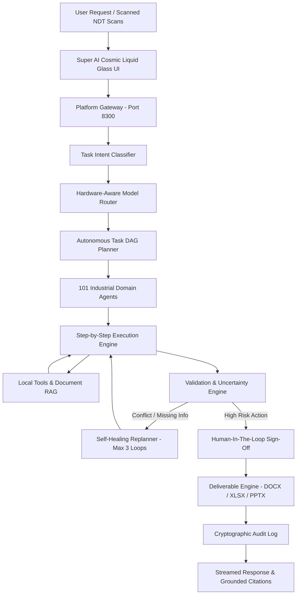

# Super AI

### 100% On-Premise Industrial Autonomous Agentic Platform
**Client / Problem Statement:** Mangalore Refinery and Petrochemicals Limited (MRPL) / Smart India Hackathon  
**Environment:** 100% Air-Gapped / On-Premise Execution (Zero External Cloud Calls)  

---

## 🌟 What is Super AI?

**Super AI** (Sovereign AI Workbench) is a secure on-premise industrial AI operating system. Built for mission-critical industrial operations where cloud LLMs violate safety and cybersecurity regulations, Super AI orchestrates a fleet of **101 autonomous agents** across **3 local open-weight AI models** (NVIDIA Nemotron 3, Google Gemma 3, Qwen 2.5 Coder) to perform complex asset integrity investigations, statutory compliance audits, and enterprise deliverable generation with **zero cloud dependencies** and **zero data egress**.

---

## 🏛️ System Architecture



---

## ⚡ Core Platform Capabilities

1. **🛡️ 100% Air-Gapped Sovereignty**: Enforced by socket-level egress monitoring (`egress-monitor.js`). Exactly `0` external calls throughout all workflows.
2. **🧠 Tri-Model Local Stack**:
   - **NVIDIA Nemotron 3** (`nemotron-3-nano`): Deep reasoning, statutory compliance checks, and multi-agent debate.
   - **Google Gemma 3** (`gemma3:4b`): Multimodal document OCR, vision inspection, and P&ID drawing reading.
   - **Qwen 2.5 Coder** (`qwen2.5-coder:1.5b`): Deterministic formula validation, scripts, and Excel calculation macros.
3. **🤖 101-Agent Workforce**:
   - **Agent 101 (Super AI)**: Master Orchestrator, goal deconstruction, cross-domain synthesis.
   - **Agents 001–100**: 100 domain specialists spanning Engineering, Safety, Operations, Compliance, and Procurement.
4. **🗺️ Autonomous DAG Planning & Self-Healing Replanning**:
   - Converts natural language goals into a structured Directed Acyclic Graph (DAG) of task steps.
   - Dynamically adapts the DAG if missing information or conflicting NDT measurements are detected (bounded by `MAX_REPLANS = 3`).
5. **🔍 Grounded Evidence Graph & Uncertainty Scoring**:
   - Every claim is tied to statutory clauses (OISD-STD-129, API-653, ASME) with calibrated confidence levels (`HIGH`, `MEDIUM`, `LOW`).
6. **👥 Human-In-The-Loop (HITL) Checkpoints**:
   - High-risk operations (e.g. emergency outage authorizations) pause execution until an authorized human engineer signs off.
7. **📄 Real Enterprise Deliverables**:
   - Generates official binary files locally: `.docx` (Executive Memo), `.xlsx` (Corrosion Grid), `.pptx` (Management Briefing Deck).
8. **✨ Cosmic Liquid Glass UI**:
   - Modern, high-performance UI featuring 5-level glass depth, responsive composer capsule, and interactive model selector.

---

## 🚀 Quick Start (10 Minutes)

### 1. Prerequisites
- **Node.js** v18.0.0+
- **Ollama** running locally on port `11434` with `OLLAMA_MODELS=E:\Smart Automation\AI\Models\Ollama`

### 2. Install & Start
```powershell
# 1. Navigate to workspace
cd "E:\Smart Automation\100-AI-Agents"

# 2. Run test matrix
npm test

# 3. Start local gateway & web UI
npm start
```
Open **`http://127.0.0.1:8300/`** in your browser.

---

## 🧪 Testing & Verification

| Test Suite | Command | Expected Result |
|---|---|---|
| **SIH Platform Matrix (28 Suites)** | `npm test` | **28/28 Passed (100%)** |
| **Workforce Fleet Test (101 Agents)** | `npm run test:fleet` | **101/101 Passed (100%)** |
| **UI & Composer Invariants** | `npm run test:ui` | **All Passed (100%)** |
| **Hardware Benchmark** | `npm run benchmark` | **100% Local Inference** |

---

## 📂 Project Structure

```
100-AI-Agents/
├── platform/
│   ├── web/               # Cosmic Liquid Glass Frontend (HTML5 / CSS3 / JS)
│   ├── gateway/           # Platform API Server & Stream Handlers (Port 8300)
│   ├── intelligence/      # Task Planner, Replanner, Execution Engine, HITL Policy
│   ├── models/            # Model Router, Task Classifier, Hardware Profiler
│   ├── knowledge/         # Local RAG Engine & Vector Store
│   ├── multimodal/        # Document Pipeline, OCR Engine, Drawing Analyzer
│   ├── evidence/          # Evidence Graph, Uncertainty Engine, Trend Analysis
│   ├── tools/             # Canonical Tool Registry & Deterministic Handlers
│   ├── deliverables/      # Official DOCX / XLSX / PPTX Document Generators
│   ├── security/          # Egress Monitor & Air-Gap Enforcement
│   └── workflow-engine/   # Industrial Workflow Engine & Predefined SOPs
│
├── agents/                # 101 Specialized Agent Implementations
├── registry/              # Single Source of Truth (sih-agent-mapping.json)
├── tests/                 # SIH Test Suites, Agent Tests, Benchmarks, UI Tests
├── scripts/               # Development, Fleet Runners, Benchmarks, Auto-Start
├── docs/                  # Master Documentation Suite (Architecture, Onboarding, SIH)
├── artifacts/             # Locally Generated Deliverables (.docx, .xlsx, .pptx)
├── package.json           # Root Project Manifest & NPM Lifecycle Scripts
└── README.md              # Project Overview & Quick Start
```

---

## 📚 Documentation Links
- [**Codebase Architecture Map**](file:///E:/Smart%20Automation/100-AI-Agents/docs/CODEBASE-ARCHITECTURE-MAP.md)
- [**How Super AI Works**](file:///E:/Smart%20Automation/100-AI-Agents/docs/architecture/HOW-SUPER-AI-WORKS.md)
- [**Request Lifecycle & Data Contracts**](file:///E:/Smart%20Automation/100-AI-Agents/docs/architecture/REQUEST-LIFECYCLE.md)
- [**Code Responsibility Matrix**](file:///E:/Smart%20Automation/100-AI-Agents/docs/CODE-RESPONSIBILITY-MATRIX.md)
- [**Developer Onboarding Guide**](file:///E:/Smart%20Automation/100-AI-Agents/docs/development/ONBOARDING.md)
- [**Troubleshooting & Diagnostics**](file:///E:/Smart%20Automation/100-AI-Agents/docs/development/TROUBLESHOOTING.md)
- [**Hackathon Jury Briefing**](file:///E:/Smart%20Automation/100-AI-Agents/docs/sih/JUDGE-CODEBASE-EXPLANATION.md)
- [**Documentation Index**](file:///E:/Smart%20Automation/100-AI-Agents/docs/README.md)
