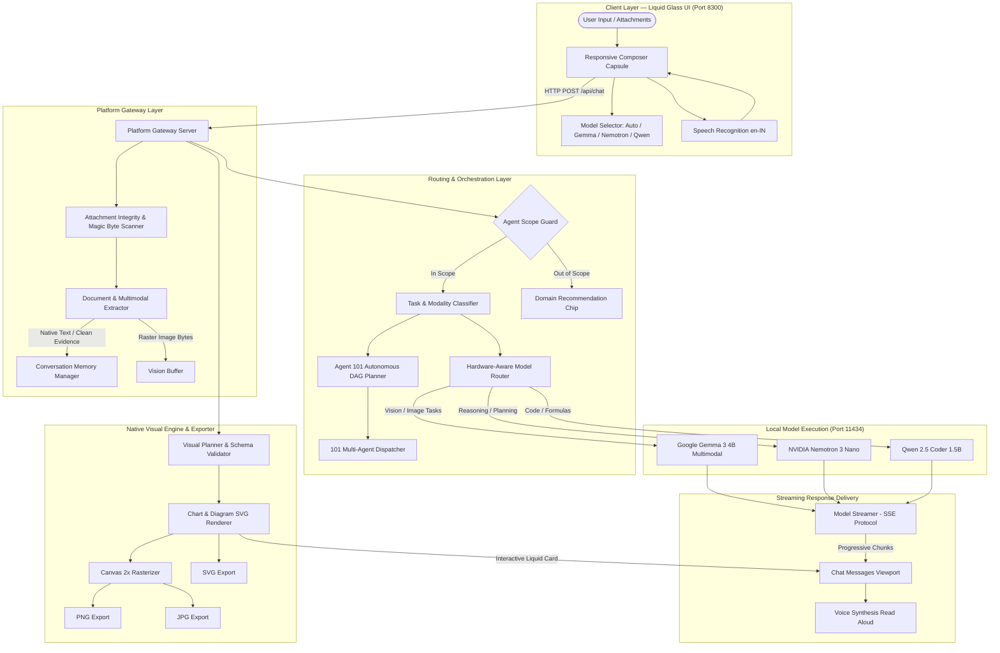
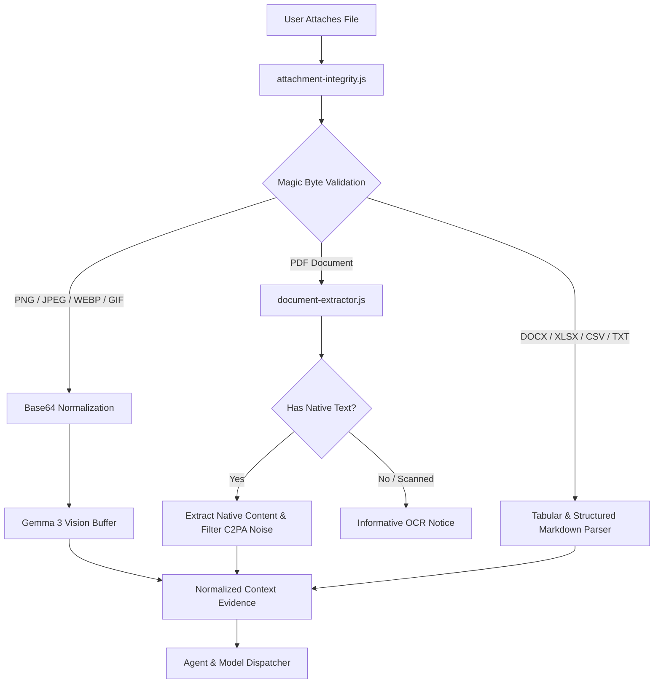

# 101 Super AI Agents

> **Intelligent Multi-Agent AI Workspace**
> A 100% local, air-gapped multi-agent platform with **100 domain specialist AI Agents** orchestrated by **Super AI Agent 101**. Powered by a tri-model local open-weight engine with multimodal document intelligence, real-time token streaming, persistent conversational memory, 18 native data visualization types, and instant high-DPI image export.

[]()
[]()
[-06b6d4.svg)]()
[]()
[-success.svg)]()
[]()

---

## 🌟 Executive Overview

**101 Super AI Agents** (built on the *Sovereign AI Workbench* architecture) is an enterprise-grade, privacy-first AI operating platform. Designed for mission-critical industrial, engineering, enterprise, and educational environments where uploading proprietary assets to public cloud LLMs violates safety and compliance regulations.

The system pairs **100 specialized autonomous agents** with a master orchestrator (**Agent 101 — Super AI Agent**) across **3 specialized local open-weight models** running strictly on-premise with **zero cloud dependencies** and **zero data egress**.

```
┌─────────────────────────────────────────────────────────────────────────────┐
│                            101 SUPER AI AGENTS                              │
│                                                                             │
│   ┌────────────────────────────────┐   ┌────────────────────────────────┐   │
│   │     AGENTS 001 – 100           │   │          AGENT 101             │   │
│   │   Domain Specialist Fleet      │   │       SUPER AI AGENT           │   │
│   │  Writing, Coding, Engineering, │   │    Master DAG Orchestrator     │   │
│   │  Research, Business, Systems   │   │  Multi-Agent Task Coordinator  │   │
│   └────────────────────────────────┘   └────────────────────────────────┘   │
│                                    ▲                                        │
│                                    │ Coordinates / Delegates                │
│                                    ▼                                        │
│   ┌─────────────────────────────────────────────────────────────────────┐   │
│   │                     LOCAL TRI-MODEL ENGINE                          │   │
│   │   Google Gemma 3        NVIDIA Nemotron 3        Qwen 2.5 Coder     │   │
│   │  (Multimodal / Vision)   (Reasoning / Logic)   (Code / Technical)   │   │
│   └─────────────────────────────────────────────────────────────────────┘   │
└─────────────────────────────────────────────────────────────────────────────┘
```

---

## ✨ Core Capabilities & Feature Highlights

- 🤖 **101 Autonomous AI Agents**: 100 focused domain specialists (`001`–`100`) and one unified master orchestrator (`101` Super AI Agent).
- 🛡️ **100% Air-Gapped Local Inference**: True zero-cloud execution with socket-level egress monitoring (`egress-monitor.js`). Exactly `0` external calls.
- 🧠 **Tri-Model Specialized Routing**: Hardware-aware local dispatching to Google Gemma 3 (`gemma3:4b`), NVIDIA Nemotron 3 (`nemotron-3-nano`), and Qwen 2.5 Coder (`qwen2.5-coder:1.5b`).
- ⚡ **True Progressive Token Streaming**: Server-Sent Events (SSE) deliver real-time token chunks with client-side cancellation and partial token preservation.
- 📄 **Multimodal Document Understanding**: Content-first text extraction for native PDFs, OCR fallback for scanned sheets, and direct image reasoning via Gemma 3 Vision.
- 🔒 **Attachment Integrity & Magic-Byte Validation**: Validates file signatures (PNG, JPEG, PDF, WEBP, GIF), base64 normalization, and SHA-256 integrity checks.
- 📊 **Native Visual Intelligence (18 Chart Types & Diagrams)**: In-chat rendered SVG data charts, flowcharts, architecture diagrams, sequence lifelines, and timelines.
- 🖼️ **High-DPI Visual Export (PNG / JPG / SVG)**: One-click local rasterization at 2x DPI with dark Liquid Glass background preservation and slugified filenames.
- 💾 **Persistent Conversational Memory**: Thread management with auto-generated titles, message search, pinning, renaming, and multi-turn context retention.
- 🎙️ **Voice Intelligence**: Web Speech API input, speech text sanitization, and warm Indian English (`en-IN`) voice profile for Read Aloud.
- 💎 **Liquid Glass UI / UX**: iPhone-inspired translucent surfaces, RGB neon ambient accents, independent double-scroll sidebar, and monospace numeric agent identity.
- 🚦 **Agent Scope Guard**: Enforces domain boundaries for specialists and provides non-disruptive recommendation chips for out-of-scope prompts.

---

## 🏛️ System Architecture



---

## 🤖 101 Super AI Agent Organization

The 101 AI Agents are categorized into specialized functional domains, registered canonically in [`registry/sih-agent-mapping.json`](file:///E:/Smart%20Automation/100-AI-Agents/registry/sih-agent-mapping.json):

| Number Range | Domain Category | Agent Count | Representative Agent Examples |
|---|---|---|---|
| **`001 – 009`** | **Writing & Communication** | 9 Agents | `001` Writing AI, `002` Email AI, `004` Copywriting AI, `008` Speech AI |
| **`010 – 013`** | **Education & Learning** | 4 Agents | `010` Tutor AI, `011` Language AI, `013` History AI |
| **`014 – 017`** | **Design & Creative** | 4 Agents | `014` UI/UX AI, `015` Logo AI, `017` Interior AI |
| **`018 – 031`** | **Automation & Productivity** | 14 Agents | `041` Email Management AI, `043` Task Automation AI, `045` PDF Processing AI |
| **`026 – 035`** | **Business & Management** | 29 Agents | `026` Company Research AI, `046` Invoice Processing AI, `076` Sales AI, `090` Project Manager AI |
| **`021 – 025`** | **Research & Knowledge** | 11 Agents | `021` Academic Research AI, `023` Research Paper AI, `093` RAG Knowledge AI |
| **`036, 055 – 070`** | **Coding & Development** | 13 Agents | `036` GitHub Research AI, `055` Code Review AI, `061` Code Generation AI, `075` Full-Stack Developer AI |
| **`047 – 049, 071`** | **Data & Analytics** | 4 Agents | `047` Spreadsheet AI, `048` Data Analysis AI, `049` Report Generation AI, `071` Database AI |
| **`051 – 054, 094`** | **Specialized AI** | 8 Agents | `051` Image Analysis AI, `052` Video Analysis AI, `094` Multi-Agent Debate AI |
| **`066, 072 – 074`** | **Security & Systems** | 4 Agents | `066` Security Audit AI, `072` DevOps AI, `073` Docker AI, `074` CI/CD AI |
| **`101`** | **Master Orchestrator** | **1 Agent** | **`101` Super AI Agent** (Autonomous DAG Planner, Model Router & Fleet Coordinator) |

---

## 🧠 Local Model Portfolio & Workload Specialization

The platform uses three local open-weight models loaded into Ollama (`http://127.0.0.1:11434`):

```
┌─────────────────────────┬────────────────────────────┬─────────────────────────────┐
│     Google Gemma 3      │     NVIDIA Nemotron 3      │       Qwen 2.5 Coder        │
│        gemma3:4b        │      nemotron-3-nano       │     qwen2.5-coder:1.5b      │
│                         │                            │                             │
│ • Multimodal Reasoning  │ • Complex DAG Planning     │ • Code Synthesis & Refactor │
│ • Photo & Defect OCR    │ • Epistemic Synthesis      │ • SQL & Database Queries    │
│ • Diagram Recognition   │ • Statutory Compliance     │ • Python & Macro Scripting  │
│ • Visual Q&A            │ • Multi-Agent Debate       │ • Regex & Data Cleaning     │
└─────────────────────────┴────────────────────────────┴─────────────────────────────┘
```

| Model | Canonical ID | Parameter Size | Primary Responsibilities | Local Endpoint |
|---|---|---|---|---|
| **Google Gemma 3** | `gemma3:4b` | 4B Multimodal | Image analysis, photo inspection, OCR, diagram understanding, visual Q&A | `http://127.0.0.1:11434` |
| **NVIDIA Nemotron 3** | `nemotron-3-nano` | 4B Reasoning | Task planning, industrial investigation, formal writing, logic synthesis | `http://127.0.0.1:11434` |
| **Qwen 2.5 Coder** | `qwen2.5-coder:1.5b` | 1.5B Coding | Automated coding, script debugging, data processing, formula generation | `http://127.0.0.1:11434` |

---

## 📊 Visual Intelligence & Export Subsystem

Agents can automatically structure complex analytical responses as interactive visual diagrams and data charts rather than plain text walls.

```
AI Model Output  ──►  Visual Specification  ──►  Sanitizer & Validator  ──►  SVG Renderer  ──►  Interactive Card
                                                                                                    │
                                                 ┌───────────────────┬───────────────────┬──────────┴──────────┐
                                                 ▼                   ▼                   ▼                     ▼
                                           [ 🖼️ PNG ]           [ 📷 JPG ]           [ 📐 SVG ]          [ ⛶ Expand ]
                                            (High-DPI 2x)       (Solid Dark BG)     (Vector Source)     (Fullscreen Modal)
```

### Supported Visual Types (18 Charts + Structural Diagrams)

1. **Comparison & Distribution**: Vertical Bar, Horizontal Bar, Grouped Bar, Stacked Bar, Histogram, Population Pyramid
2. **Composition & KPIs**: Pie Chart (with 100% single-slice arc handling), Donut Chart (with center KPI readout), Waterfall Chart, Gauge Chart
3. **Trends & Continuous Data**: Line Chart (with single-point dot rendering), Area Chart, Stacked Area Chart
4. **Correlation & Multi-Dimensional**: Scatter Plot, Bubble Chart, Box Plot (min/q1/median/q3/max), Heatmap Matrix, Radar Chart
5. **Structural & Process**: Flowcharts (TB/LR), Multi-Tier System Architecture, Sequence Diagrams (actors & lifelines), Chronological Timelines, Mermaid syntax

### Visual Export Capabilities
- **PNG Export**: Local Canvas rasterization at **2x pixel density**, preserving font definitions and RGB neon accents.
- **JPG Export**: Rasterized over solid `#0b1120` dark theme background to prevent transparency artifacts.
- **SVG Export**: Direct XML vector download.
- **Descriptive Naming**: Automatic slugification (e.g., `quarterly-revenue-bar-chart.png`).
- **Clipboard Copy**: Direct image copying via browser `ClipboardItem` API.

---

## 📄 Multimodal Document Pipeline

The document pipeline processes arbitrary uploaded files locally with format-specific parsing strategies:



- **Native PDF First**: Extracts text from PDF stream operators (`BT/ET`, `Tj/TJ`) and filters out C2PA metadata, XMP blocks, and structural object tables.
- **Image Safety**: Scanned PDF raw `%PDF-` bytes are never forwarded to vision models as fake raster images.
- **Attachment-Only Send**: Users can upload files without entering text; the interface automatically initializes the relevant task prompt.

---

## 🚀 Getting Started

### Prerequisites

- **Node.js**: v18.0.0 or higher
- **Ollama**: Running locally at `http://127.0.0.1:11434` with models pulled:
  ```bash
  ollama pull gemma3:4b
  ollama pull nemotron-3-nano
  ollama pull qwen2.5-coder:1.5b
  ```

### Installation & Launch

```powershell
# 1. Clone repository & enter workspace
git clone https://github.com/reginaldalfret/100-AI-Agents.git
cd 100-AI-Agents

# 2. Install dependencies (standard Node.js with native ESM)
npm install

# 3. Start the Platform Gateway (Port 8300)
npm start
```

Open **`http://127.0.0.1:8300/`** in your browser to access the **101 Super AI Agents** workspace.

---

## 🧪 Comprehensive Verification & Test Suites

The codebase includes test coverage across all subsystems. Tests run using Node.js built-in test runner:

```powershell
# 1. Run Complete Platform Matrix (28 Test Suites)
npm test

# 2. Run Full 101 AI Agent Fleet Health & Dispatch Test
npm run test:fleet

# 3. Run Visual Export Tests (PNG, JPG, SVG, Diagrams, 18 Charts)
node --test tests/visuals/png-export.test.js
node --test tests/visuals/jpg-export.test.js
node --test tests/visuals/diagram-export.test.js
node --test tests/visuals/chart-comprehensive.test.js

# 4. Run Multimodal & Attachment Integrity Tests
node --test tests/multimodal/attachment-integrity.test.js
node --test tests/multimodal/pdf-native-text.test.js
node --test tests/multimodal/real-gemma-vision.test.js

# 5. Run True Progressive Token Streaming Tests
node tests/streaming/true-token-streaming.test.js

# 6. Run UI & Conversational History Tests
node --test tests/ui/attachment-only-send.test.js
node --test tests/ui/model-selector.test.js
node --test tests/ui/conversation-history.test.js
```

### Latest Verification Results

| Subsystem | Test Suite / Scope | Verified Result |
|---|---|---|
| **Visual Exports** | PNG, JPG, SVG, Diagram & 18-Chart Renderers | **48/48 Passed (100%)** |
| **Multimodal Pipeline** | Attachment Integrity, PDF Native Text, Gemma 3 Vision | **13/13 Passed (100%)** |
| **Token Streaming** | SSE Token Streaming, Model Classification, Stream Abort | **3/3 Passed (100%)** |
| **UI Components** | Attachment Send, Model Selector, History Persistence | **26/26 Passed (100%)** |
| **SIH Platform Matrix** | 28 Comprehensive Architecture & Benchmark Suites | **28/28 Suites Passed (100%)** |
| **Workforce Fleet** | All 101 AI Agents Initialized and Verified | **101/101 Passed (100%)** |
| **Air-Gap Egress** | Socket-Level Network Monitor (`egress-monitor.js`) | **0 External Calls** |

---

## 📂 Repository Structure

```
100-AI-Agents/
├── agents/                       # 101 Specialized Agent Implementations
│   ├── agent-001-writing-agent/
│   ├── ...
│   └── agent-101-master-agent/   # Master Orchestrator Implementation
│
├── platform/                     # Core Platform Subsystems
│   ├── gateway/                  # Platform API & SSE Streaming Server (Port 8300)
│   ├── intelligence/             # Autonomous DAG Planner, Replanner, Execution Engine
│   ├── models/                   # Model Router, Task Classifier, Hardware Profiler
│   ├── multimodal/               # Document Extractor, Attachment Integrity Scanner
│   ├── visuals/                  # 18 Chart Renderers, Diagram Renderers, Exporters
│   ├── voice/                    # Speech Sanitizer, Voice Profile (en-IN), Voice Service
│   ├── context/                  # Conversation Manager, Context Builder
│   ├── evidence/                 # Evidence Graph, Uncertainty Engine, Trend Analysis
│   ├── security/                 # Egress Monitor & Air-Gap Enforcement Policies
│   ├── tools/                    # Tool Registry & Deterministic Tool Handlers
│   └── web/                      # Liquid Glass Web Workspace (HTML5 / CSS3 / Vanilla JS)
│
├── registry/                     # Authoritative Registries
│   ├── sih-agent-mapping.json    # Canonical 101-Agent Single Source of Truth
│   ├── agents.json               # Fast Agent Lookups
│   └── sa-s03-agent-mapping.json # Domain Mapping Configurations
│
├── tests/                        # Comprehensive Test Suites
│   ├── visuals/                  # PNG, JPG, SVG, and 18-Chart Render Tests
│   ├── multimodal/               # Native PDF, Attachment Integrity, Vision Tests
│   ├── streaming/                # SSE Progressive Token Streaming Tests
│   ├── ui/                       # Composer, Model Selector, History Tests
│   ├── sih/                      # 28-Suite SIH Platform Regression Matrix
│   └── run-all-agents.js         # 101 Agent Fleet Concurrency Runner
│
├── docs/                         # Technical Architecture & Developer Guides
│   ├── architecture/             # How Super AI Works, Request Lifecycle, Visuals, PDF
│   ├── development/              # Onboarding, Diagram Guides, Troubleshooting
│   └── sih/                      # Judge Briefings, Performance Q&A, Demos
│
├── package.json                  # Project Manifest & NPM Lifecycle Scripts
└── README.md                     # Authoritative Master Documentation
```

---

## 💡 Example Prompt Queries

Try these prompts directly in the chat interface:

- **Data Visualizations**:
  `"Create a pie chart showing: Python 40, Java 25, JavaScript 20, Other 15."`
  `"Create a line chart showing monthly sales: Jan 100, Feb 120, Mar 160, Apr 150, May 210."`
  `"Create a histogram from this dataset: 2, 3, 3, 4, 4, 5, 5, 5, 6, 7, 7, 8, 10."`
- **System Architecture & Flowcharts**:
  `"Show the architecture of 101 Super AI Agents."`
  `"Create a flowchart explaining how a user request routes between Gemma 3, Nemotron 3, and Qwen 2.5 Coder."`
- **Multimodal Document Q&A**:
  Upload a PDF document and ask: `"Extract the key findings and summarize the action items."`
  Upload an image and ask: `"Analyze this image and explain the components shown."`
- **Agent 101 Multi-Agent Coordination**:
  `"Coordinate a multi-step project: write an executive summary, design the system architecture diagram, and write the backend code."`

---

## 📚 Technical Documentation Index

For in-depth architectural and developer documentation, explore:

- [**How Super AI Works**](file:///E:/Smart%20Automation/100-AI-Agents/docs/architecture/HOW-SUPER-AI-WORKS.md) — End-to-end orchestration and execution mechanics.
- [**Request Lifecycle & Data Contracts**](file:///E:/Smart%20Automation/100-AI-Agents/docs/architecture/REQUEST-LIFECYCLE.md) — Payload contracts and routing phases.
- [**Visual Output System Architecture**](file:///E:/Smart%20Automation/100-AI-Agents/docs/architecture/VISUAL-OUTPUT-SYSTEM.md) — 18-chart and diagram architecture.
- [**Diagram Developer Guide**](file:///E:/Smart%20Automation/100-AI-Agents/docs/development/DIAGRAM-DEVELOPER-GUIDE.md) — How to add and customize visual types.
- [**PDF Content-First Architecture**](file:///E:/Smart%20Automation/100-AI-Agents/docs/architecture/PDF-CONTENT-FIRST-ARCHITECTURE.md) — Native extraction vs OCR logic.
- [**Agent Scope Enforcement**](file:///E:/Smart%20Automation/100-AI-Agents/docs/architecture/AGENT-SCOPE-ENFORCEMENT.md) — Domain boundary policy.
- [**Voice Architecture & Indian English Profile**](file:///E:/Smart%20Automation/100-AI-Agents/docs/architecture/VOICE-ARCHITECTURE.md) — Speech subsystem details.
- [**Developer Onboarding Guide**](file:///E:/Smart%20Automation/100-AI-Agents/docs/development/ONBOARDING.md) — Setting up the workspace.
- [**Troubleshooting & Diagnostics**](file:///E:/Smart%20Automation/100-AI-Agents/docs/development/TROUBLESHOOTING.md) — Resolving local environment issues.
- [**Hackathon Judge Briefing**](file:///E:/Smart%20Automation/100-AI-Agents/docs/sih/JUDGE-CODEBASE-EXPLANATION.md) — Technical evaluation summary.

---

## ❓ Frequently Asked Questions (FAQ)

<details>
<summary><strong>Q: What is the difference between Agent 101 and Agents 001–100?</strong></summary>
Agents <code>001</code>–<code>100</code> are domain specialists (e.g. <code>001</code> Writing AI, <code>045</code> PDF AI, <code>061</code> Code Gen AI) optimized for specific task scopes. <strong>Agent 101 (Super AI Agent)</strong> is the master orchestrator capable of autonomous multi-step planning, dynamic model routing, and delegating subtasks across the specialist fleet.
</details>

<details>
<summary><strong>Q: Does 101 Super AI Agents send data to OpenAI, Anthropic, or external clouds?</strong></summary>
<strong>No. Exactly 0 external calls are made.</strong> All reasoning, multimodal image parsing, PDF extraction, diagram rendering, and token streaming execute 100% on-premise using local open-weight models via Ollama.
</details>

<details>
<summary><strong>Q: How does the platform run 101 agents on consumer hardware?</strong></summary>
The 101 agents share the lightweight platform runtime and execute on-demand against 3 local open-weight models with a strict <code>MAX_GPU_CONCURRENCY = 1</code> execution lock, ensuring zero VRAM overflow on entry-level GPUs (such as the NVIDIA RTX 2050 4GB).
</details>

<details>
<summary><strong>Q: Can charts and diagrams be exported as images?</strong></summary>
Yes. Every rendered chart or diagram includes one-click <strong>[ PNG ]</strong> (high-DPI 2x), <strong>[ JPG ]</strong> (solid dark background), and <strong>[ SVG ]</strong> download controls, rendered entirely in the browser using the HTML5 Canvas API without GPU or cloud overhead.
</details>

<details>
<summary><strong>Q: What happens if a specialist agent receives a request outside its domain?</strong></summary>
The <strong>Agent Scope Guard</strong> intercepts the query, provides a helpful response explaining its primary role, and suggests one-click recommendation chips to switch to the appropriate specialist or Agent 101.
</details>

---

## 📄 License

This project is licensed under the MIT License — see the [LICENSE](LICENSE) file for details.
