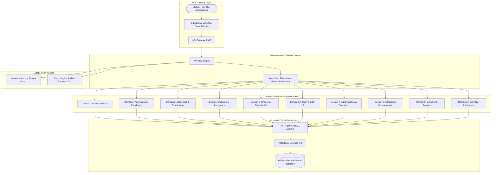

# SA-S03 Educational AI Agent Workforce Architecture

**Project:** SA-S03 — Automated Workflow Management Platform Software  
**Version:** 2.0.0 (Educational Workforce Baseline)  
**Hardware Profile:** 8GB System RAM / 4GB NVIDIA VRAM (RTX 2050)  
**Inference Engine:** NVIDIA Nemotron 3 Nano 4B Q4_K_M via local Ollama daemon  
**Orchestration Paradigm:** Educational Master Orchestrator (Agent 101) with Dynamic 100-Agent Workforce  

---

## 1. Executive System Overview
The SA-S03 platform transforms the 100-to-1 multi-agent infrastructure into an enterprise-grade **Educational Intelligent Workflow Management Platform** tailored for universities, colleges, and government education departments. 

Instead of a generic chatbot interface, SA-S03 establishes a strictly coordinated workforce where **100 specialized agents** are categorized into **10 functional educational domains**, governed by a central **Master Workflow Orchestrator (Agent 101)**, interacting through an authenticated **Tool Registry** and authoritative **Institutional Service Layer**.

---

## 2. The 10 Educational Functional Domains

### Domain 1: Student Services (`student-services`)
- **Key Responsibilities:** Student identity verification, profile management, enrollment status checks, and academic advisory.
- **Representative Agents:** 
  - `agent-040`: Student Verification & Profile Intake Agent
  - `agent-018`: Student Academic & Career Advisory Agent
  - `agent-060`: Student Inquiries & Support Agent

### Domain 2: Admissions & Enrollment (`admission`)
- **Key Responsibilities:** Application dossier intake, entrance exam rank scoring, composite merit ranking, seat allocation, and enrollment confirmation.
- **Representative Agents:** 
  - `agent-077`: Admission Application Intake & Merit Evaluation Agent
  - `agent-015`: Applicant Interview & Screening Assessment Agent
  - `agent-076`: Program Onboarding & Seat Allocation Agent

### Domain 3: Academics & Examination (`academic`)
- **Key Responsibilities:** Course catalog audits, prerequisite satisfaction checks, grading scale computation, exam score validation, and academic warnings.
- **Representative Agents:** 
  - `agent-003`: Curriculum & Academic Study Plan Agent
  - `agent-034`: Course Catalog & Prerequisite Validation Agent
  - `agent-004`: Academic Examination & Assessment Validation Agent

### Domain 4: Document Intelligence (`document-intelligence`)
- **Key Responsibilities:** PDF transcript parsing, OCR/Vision extraction, certificate tamper verification, and multi-document consistency correlation.
- **Representative Agents:** 
  - `agent-045`: Institutional PDF & Transcript Processing Agent
  - `agent-051`: Institutional Certificate & ID Image Verification Agent
  - `agent-037`: Institutional Document Research & Policy Lookup Agent

### Domain 5: Finance & Financial Aid (`finance`)
- **Key Responsibilities:** Tuition invoice processing, bursar fee balance checks, scholarship eligibility evaluation, and fee ledger disbursement.
- **Representative Agents:** 
  - `agent-085`: Scholarship & Financial Aid Eligibility Evaluator Agent
  - `agent-046`: Institutional Fee Invoice & Receipt Verification Agent
  - `agent-086`: Institutional Accounting & Ledger Balance Agent

### Domain 6: Faculty & Staff HR (`faculty-hr`)
- **Key Responsibilities:** Faculty profile management, teaching workload utilization tracking, committee review coordination, and leave audits.
- **Representative Agents:** 
  - `agent-089`: Faculty Affairs & Departmental Committee HR Agent
  - `agent-042`: Academic Scheduling & Committee Meeting Assistant Agent

### Domain 7: Administration & Operations (`administration`)
- **Key Responsibilities:** Administrative task decomposition, deadline tracking, institutional policy enforcement, and record archiving.
- **Representative Agents:** 
  - `agent-012`: Administrative Task Management Agent
  - `agent-043`: Administrative Task Automation Agent
  - `agent-095`: Institutional Operations Process Agent

### Domain 8: Institutional Communication (`communication`)
- **Key Responsibilities:** Official decision notices, automated student/faculty emails, multilingual document translations, and deadline alerts.
- **Representative Agents:** 
  - `agent-002`: Official Institutional Notice & Email Communication Agent
  - `agent-001`: Institutional Formal Document & Letter Drafting Agent
  - `agent-007`: Multilingual Student Translation & Accessibility Agent

### Domain 9: Institutional Analytics & Reporting (`analytics`)
- **Key Responsibilities:** Attendance risk detection, academic grade distribution analysis, retention forecasting, and executive accreditation reports.
- **Representative Agents:** 
  - `agent-048`: Institutional Academic & Attendance Analytics Agent
  - `agent-049`: Institutional Performance & Accreditation Reporting Agent
  - `agent-017`: Institutional SWOT Analysis & Program Review Agent

### Domain 10: Workflow & Multi-Agent Intelligence (`workflow-intelligence`)
- **Key Responsibilities:** Multi-agent consensus validation, subtask dispatch, pipeline health monitoring, and institutional data persistence.
- **Representative Agents:** 
  - `agent-100`: Sub-Workflow Orchestration & Task Execution Agent
  - `agent-099`: Multi-Agent Consensus & Evidence Aggregator Agent
  - `agent-071`: Institutional Data Gateway & Persistence Agent

---

## 3. Tool Architecture & Role-Based Access Control (RBAC)
Agents do not directly access raw databases. All interactions occur via strictly validated tools in `platform/tools/tool-registry.js`:

| Tool Category | Tool Name | Allowed Roles / Domains | Description |
| :--- | :--- | :--- | :--- |
| **Student** | `get_student_profile` | Student Services, Academic, Orchestration | Retrieves authoritative student profile |
| **Student** | `verify_student_identity` | Student Services, Document Intelligence | Validates verified government ID proof |
| **Academic** | `get_attendance` | Academic, Analytics, Orchestration | Queries class attendance rate and risk flag |
| **Academic** | `get_prerequisites` | Academic, Student Advisory, Orchestration | Evaluates prerequisite course satisfaction |
| **Finance** | `get_fee_status` | Finance, Administration, Orchestration | Queries tuition balance and clearance state |
| **Finance** | `check_financial_eligibility`| Finance, Scholarship Evaluators | Assesses income thresholds & merit GPA |
| **Document** | `extract_document_data` | Document Intelligence | Extracts structured fields from PDF/OCR |
| **Document** | `verify_document` | Document Intelligence | Performs cryptographic tamper hash checks |
| **Admission** | `calculate_merit` | Admissions, Orchestration | Computes weighted entrance merit ranking |
| **Communication**| `send_email` | Communication, Notices, Orchestration | Dispatches formal institutional email |
| **Audit** | `record_agent_action` | All Workforce Agents | Logs immutable chronological audit entries |

---

## 4. Evidence-Based Decision Model
To prevent hallucinations and maintain institutional compliance, every specialist agent differentiates:
1. **DATA:** Raw immutable facts queried from authoritative services.
2. **INFERENCE:** Model-derived reasoning grounded in verifiable policy thresholds.
3. **DECISION:** Explicit actionable outcomes attached with structured evidence records.

---

## 5. Human-in-the-Loop (HITL) Governance
Workflows pause automatically at high-risk decision gates (e.g. Admission Approval, Scholarship Grant Award, Course Prerequisite Override, Degree Conferral). Authorized Committee members and Deans review the compiled agent evidence and submit immutable approvals or rejections.
