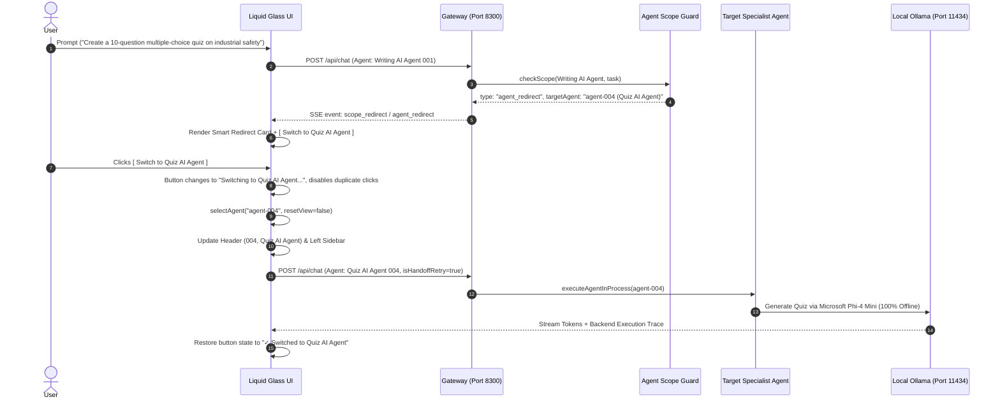

# Smart Agent Handoff & Auto-Rerouting Architecture

## Overview

In the **301 Super AI Agents** workbench, each specialist agent operates within a defined domain boundary (e.g. `Writing AI Agent` for essays and articles, `Quiz AI Agent` for assessments and multiple-choice questions, `Email AI Agent` for business correspondence, `Python AsyncIO AI Agent` for code generation).

When a user submits a prompt to an agent that belongs to another domain, the **Agent Scope Guard** detects the mismatch before model execution and initiates a **Smart Handoff**:

1. Intercepts out-of-scope requests before wasteful inference cycles.
2. Returns structured redirect metadata with zero harsh language.
3. Renders an interactive **Smart Redirect Card** with a 1-click `[ Switch to <Target Specialist> ]` button.
4. Switches the active workspace, updates headers and sidebar selection, and preserves chat history.
5. **Automatically re-runs the original prompt** with the new specialist without requiring the user to retype or copy-paste.

---

## 1. Handoff Lifecycle



---

## 2. Structured Redirect Metadata Contract

The backend returns a standard JSON contract over REST or Server-Sent Events (`scope_redirect` / `agent_redirect`):

```json
{
  "type": "agent_redirect",
  "status": "out_of_scope",
  "confidence": 0.98,
  "sourceAgent": {
    "id": "agent-001",
    "number": "001",
    "name": "Writing AI Agent"
  },
  "targetAgent": {
    "id": "agent-004",
    "number": "004",
    "name": "Quiz AI Agent"
  },
  "reason": "quiz_generation",
  "originalPrompt": "Create a 10-question multiple-choice quiz on industrial safety",
  "politeMessage": "This request is outside my specialization.\n\nI'm specialized in writing articles, essays, and editorial content. This request is better handled by the **Quiz AI Agent**."
}
```

---

## 3. UI Component Specification

The `renderAgentRedirectCard` component generates liquid glass markup:

```html
<div class="scope-redirect-card" data-source-id="agent-001" data-target-id="agent-004">
  <div class="scope-redirect-header">
    <span class="sparkle">✦</span>
    <span>Outside My Specialization</span>
  </div>
  <div class="scope-redirect-body">
    <p>This request is outside my specialization.</p>
    <p>I'm specialized in writing articles, essays, and editorial content. This request is better handled by the <strong>Quiz AI Agent</strong>.</p>
  </div>
  <div class="scope-redirect-action">
    <button class="btn-switch-agent"
            role="button"
            aria-label="Switch to Quiz AI Agent"
            data-target-id="agent-004"
            data-prompt="Create a 10-question multiple-choice quiz on industrial safety"
            onclick="window.executeAgentSwitch(this, 'agent-004', 'Create a 10-question multiple-choice quiz on industrial safety')">
      <span class="switch-icon">↗</span>
      <span class="switch-label">Switch to Quiz AI Agent</span>
    </button>
  </div>
</div>
```

---

## 4. Key Guarantees

| Feature | Guarantee |
|---|---|
| **Zero Manual Retyping** | Original prompt is preserved and automatically re-executed on switch. |
| **No Chat Wiping** | Current conversation ID, attachments, timestamps, and prior turns remain intact. |
| **Clean Trace** | Post-handoff backend trace reflects the target specialist (e.g. `Quiz AI Agent (004)`) and its model. |
| **Zero Canned Responses** | Target specialist invokes genuine local model inference without static placeholders. |
| **Zero Cloud Egress** | 100% on-premise execution across RTX 2050 GPU and local Ollama. |
| **Polite Language** | Zero harsh words (`cannot`, `not my job`, `wrong agent`, `error`, `rejected`). |
