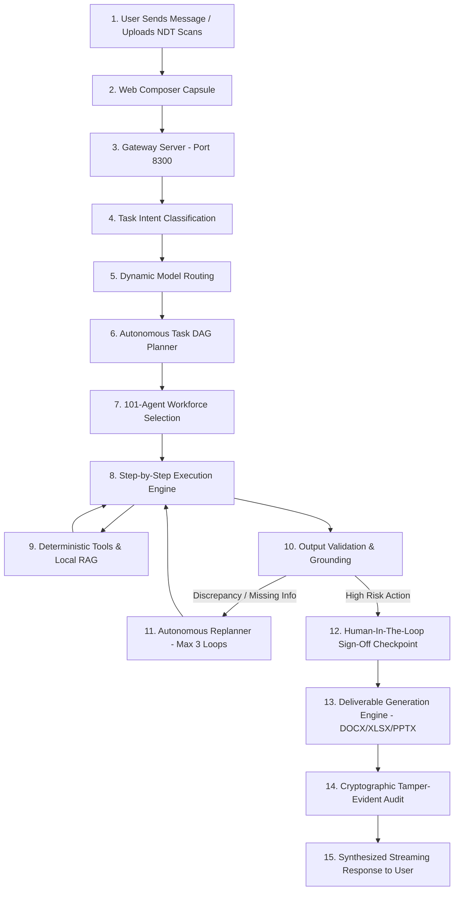

# How Super AI Works — End-to-End Architectural Walkthrough

This document explains the step-by-step lifecycle of a request in **Super AI**, from the user typing a prompt in the chat composer to the generation of official engineering deliverables and audit trail.

---

## 1. High-Level Pipeline Flow

---

## 2. Detailed Step-by-Step Breakdown

### Step 1 & 2: User Input & Liquid Glass Composer
The user enters a natural language industrial request (e.g. *"Investigate ultrasonic thickness readings for Heat Exchanger HX-204 and prepare an outage approval note"*) or uploads scanned NDT PDFs/images. The client controller bundles the payload with the selected model mode (`Auto`, `Gemma 3`, `Nemotron 3`, `Qwen 2.5 Coder`).

### Step 3: Gateway Server (`platform/gateway/src/server.js`)
The request arrives at the local HTTP/SSE gateway on port `8300`. The gateway applies security headers, validates input schemas, tracks active memory context, and forwards the payload to the Intelligence Layer.

### Step 4: Fast Task Classification (`platform/models/task-classifier.js`)
The task classifier analyzes the prompt and attachment types to determine the primary capability required:
- `REASONING_ANALYSIS`: Complex logic, root cause analysis, statutory safety auditing.
- `VISION_OCR`: Scanned PDF reading, technical P&ID drawing analysis, corrosion photo inspection.
- `CODE_GENERATION`: Calculation scripting, data transformation, spreadsheet formulas.

### Step 5: Dynamic Local Model Routing (`platform/models/model-router.js`)
When in `Auto` mode, the model router selects the optimal local engine:
- **NVIDIA Nemotron 3** (`nemotron-3-nano`): Deep reasoning, statutory compliance checks, multi-agent debate.
- **Google Gemma 3** (`gemma3:4b`): Multimodal document OCR, vision inspection, and layout parsing.
- **Qwen 2.5 Coder** (`qwen2.5-coder:1.5b`): Deterministic formula validation, scripts, and spreadsheet macros.

### Step 6 & 7: Autonomous Task Planning & Agent Selection
The Task Planner (`platform/intelligence/task-planner.js`) queries the canonical agent registry (`registry/sih-agent-mapping.json`) and constructs a Directed Acyclic Graph (DAG) of discrete tasks. For an asset inspection goal, it assigns:
- Step 1: **Agent 045 (PDF Processing)** → OCR extract wall thickness values.
- Step 2: **Agent 006 (Equipment Records)** → Fetch baseline asset design thickness.
- Step 3: **Agent 048 (Data Analysis)** → Calculate short-term & long-term corrosion rates.
- Step 4: **Agent 004 (Safety & Hazards)** → Audit against OISD-STD-129 / API-653 limits.
- Step 5: **Agent 101 (Super AI)** → Synthesize executive briefing and package deliverables.

### Step 8 & 9: Execution Engine & Local Deterministic Tools
The Execution Engine executes the DAG step-by-step. Each agent executes within an isolated sandbox, querying the local RAG engine (`platform/knowledge/`) for statutory clauses and invoking certified tools from `platform/tools/tool-registry.js`.

### Step 10 & 11: Validation, Uncertainty & Self-Healing Replanning
Each step output is checked for factuality and grounding:
- The **Uncertainty Engine** (`platform/evidence/uncertainty-engine.js`) computes completeness and confidence scores.
- If missing data (e.g. unknown operating temperature) or conflicting thickness numbers are found, the **Replanner** (`platform/intelligence/replanner.js`) dynamically injects targeted query steps into the DAG (bounded by `MAX_REPLANS = 3`).

### Step 12: Human-In-The-Loop (HITL) Checkpoint
If an investigation recommends an emergency plant shutdown or equipment modification, the execution engine pauses and generates an interactive approval card with full evidence provenance, requiring an authorized engineer's sign-off before proceeding.

### Step 13 & 14: Deliverables & Cryptographic Audit
The Deliverable Engine (`platform/deliverables/`) generates official binary files:
- `Approval_Note_HX204.docx`: Official memo for General Manager Operations.
- `Inspection_Analysis_HX204.xlsx`: Multi-year ultrasonic thickness grid with metal loss formulas.
- `Management_Briefing_HX204.pptx`: 4-slide executive briefing deck.
The Audit Service logs every step, tool invocation, and human decision into an append-only JSONL log with zero cloud egress.

### Step 15: Stream to UI
The gateway streams the structured response, grounded citations, confidence badge (`● High 95%`), deliverable download chips, and expandable execution trace back to the user interface.
