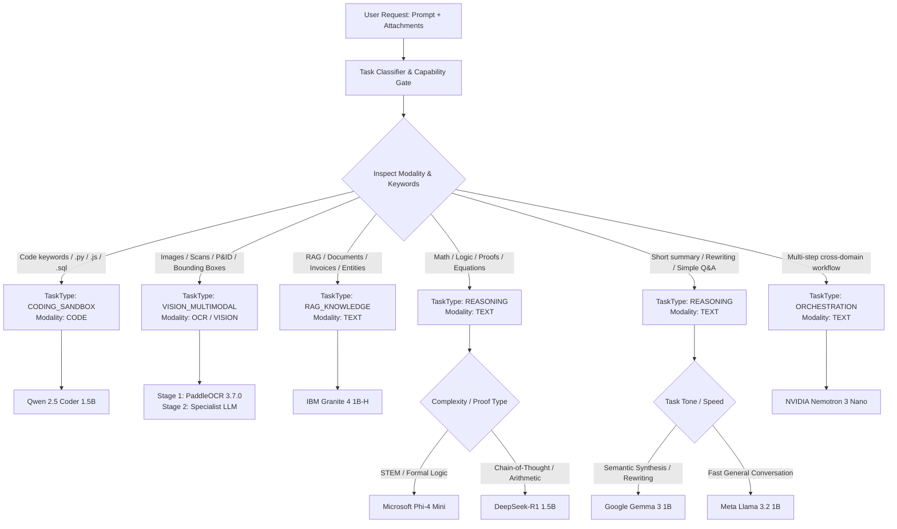
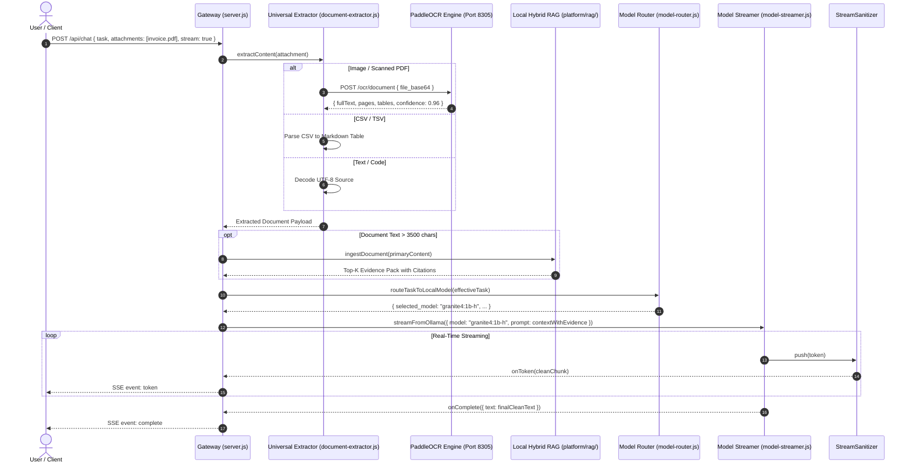

# Multimodal Routing & Model Selection Architecture

> **Subsystem**: Multimodal Intent Routing & Model Dispatch  
> **Source Modules**: `platform/models/model-router.js`, `platform/models/task-classifier.js`, `platform/models/model-registry.js`, `platform/intelligence/router.js`, `platform/gateway/src/server.js`  
> **Hardware Target**: NVIDIA GeForce RTX 2050 (4GB VRAM) · 16GB System RAM · Windows 11  
> **Air-Gap Guarantee**: 100% On-Premise Execution · 0 External Network Calls · Zero Cloud Egress  
> **Status**: Production

---

## 1. Executive Summary

The Sovereign AI Workbench features an intelligent **Multimodal Routing Engine** that automatically classifies incoming user tasks, analyzes multi-format attachments (scanned PDFs, P&ID schematics, defect photos, spreadsheets, code files), and routes execution to the optimal local open-weight model.

By combining specialized domain routing, a two-stage optical extraction pipeline, and strict single-GPU concurrency mutex controls, the system delivers high accuracy and rapid Time-To-First-Token (TTFT) on constrained 4GB VRAM consumer hardware.

---

## 2. Modality & Task Classification Architecture

Task classification is performed deterministically before model invocation by `platform/models/task-classifier.js` and `platform/intelligence/intent-engine.js`:



### 2.1 Supported Modalities

```javascript
export const ModelModality = {
  TEXT: "text",
  VISION: "vision",
  CODE: "code",
  OCR: "ocr",
  EMBEDDING: "embedding"
};
```

### 2.2 Task Types

| Task Type | Trigger Signals | Primary Modality | Default Model |
| :--- | :--- | :--- | :--- |
| `CODING_SANDBOX` | Keywords: `python`, `script`, `c++`, `java`, `debug`, `sql`, `regex`, `function`, `class`, `.py`, `.js`, `.cpp` | `code` | `qwen2.5-coder:1.5b` |
| `VISION_MULTIMODAL` | Attachments: `.png`, `.jpg`, `.pdf`, `.dwg`, or keywords: `p&id`, `drawing`, `scan`, `ocr`, `defect` | `ocr` / `vision` | `paddleocr-engine` → Specialist LLM |
| `RAG_KNOWLEDGE` | Keywords: `rag`, `document`, `table`, `extract entities`, `classify`, `tool call`, `enterprise` | `text` | `granite4:1b-h` |
| `REASONING` (Deep/Math) | Keywords: `calculate`, `math`, `formula`, `proof`, `logic problem`, `step-by-step`, `why this algorithm works` | `text` | `phi4-mini` / `smollm2:1.7b` |
| `REASONING` (Fast/NLP) | Keywords: `rewrite`, `rephrase`, `proofread`, `summarize this`, `short summary`, `quick question` | `text` | `gemma3:1b` / `llama3.2:1b` |
| `ORCHESTRATION` | Multi-agent requests, complex industrial SOPs, cross-domain objectives | `text` | `nemotron-3-nano:latest` |

---

## 3. The 7 Local Open-Weight Models & Production Registry

All 7 text/code/reasoning models run strictly on-premise through local Ollama (`http://127.0.0.1:11434`), complemented by the dedicated local OCR engine (`http://127.0.0.1:8305`) and offline STT/TTS voice engines.

| Model Family | Canonical Runtime Tag | Quantization | VRAM Footprint | Context Window | Primary Specialization & Strengths |
| :--- | :--- | :--- | :--- | :--- | :--- |
| **1. NVIDIA Nemotron 3 Nano** | `nemotron-3-nano:latest` | 4B Q4_K_M | ~2.8 GB | 4,096 | **Super AI Orchestration & Deep Epistemic Reasoning**<br>Multi-agent decomposition, SOP synthesis, hazard assessments, structured JSON planning. |
| **2. Qwen 2.5 Coder** | `qwen2.5-coder:1.5b` | 1.5B Q4_K_M | ~1.2 GB | 4,096 | **Multi-Language Code Generation & Sandbox Execution**<br>Python, C++, Java, JS, Rust, SQL, AST parsing, SCADA telemetry parsing, script refactoring. |
| **3. Google Gemma 3 1B** | `gemma3:1b` | 1B Q4_K_M | ~815 MB | 32,768 | **Edge NLP, Syntactic Parsing & Semantic Synthesis**<br>High-throughput dense transformer, contextual summarization, structured rewriting, deductive Q&A. |
| **4. Meta Llama 3.2 1B** | `llama3.2:1b` | 1B Q4_K_M | ~1.3 GB | 8,192 | **Fast Lightweight General Text & Low-Latency Assistance**<br>Rapid conversational replies, text rewriting, quick document drafting, latency-critical Q&A. |
| **5. IBM Granite 4 1B-H** | `granite4:1b-h` | 1B Q4_K_M | ~1.2 GB | 8,192 | **Enterprise RAG, Entity Extraction & Tool Invocations**<br>Deterministic entity extraction, classification, structured evidence retrieval, enterprise workflows. |
| **6. Microsoft Phi-4 Mini** | `phi4-mini` | 3.8B Q4_K_M | ~2.4 GB | 16,384 | **Advanced Reasoning, Mathematics & STEM Logic**<br>Complex algorithmic proofs, formal mathematical deductions, algorithmic planning, long-context logic. |
| **7. DeepSeek-R1 1.5B** | `smollm2:1.7b` | 1.5B Q4_K_M | ~1.1 GB | 131,072 | **Lightweight Chain-of-Thought Reasoning & Arithmetic**<br>Step-by-step logic deduction, arithmetic calculations, analytical explanations (with stream sanitization). |
| **OCR Document Engine** | `paddleocr-engine` | FP32 / Int8 | ~1.2 GB (or CPU) | 8,192 | **Production Document Intelligence & Multi-Script OCR**<br>PaddleOCR 3.7.0, PP-OCRv6 Small, PP-StructureV3, SLANet tables, PP-FormulaNet LaTeX (50 languages + Tamil & Hindi). |
| **Faster-Whisper Tiny** | `tiny.en` | Int8 ONNX | ~78 MB RAM | N/A | **100% Offline Speech-to-Text (Voice Input)**<br>Local audio capture, zero network streaming, transient memory lifecycle. |

---

## 4. Two-Stage Multimodal Processing Pipeline

When documents, images, or tabular attachments are uploaded:



---

## 5. Strict "No-Silent-Fallback" Model Routing Policy

The gateway enforces a transparent model selection policy:

1. **Auto Mode (`modelMode: "auto"`)**:
   The Task Classifier selects the optimal model from the 7 local open-weight options based on semantic features, language, attachments, and computational complexity.

2. **Manual Selection / Override (`modelMode: "manual"` / `model_override: "<tag>"`):**
   The user explicitly selects a model via the Liquid Glass UI model selector.
   - **Verification**: The gateway queries the local Ollama tag cache (`/api/tags`).
   - **No-Silent-Fallback**: If the requested model is not currently installed or available in Ollama, the gateway **immediately returns HTTP 503 `model_unavailable` with error code `MODEL_NOT_FOUND`**. It **never silently substitutes** another model without user consent.

```json
{
  "status": "model_unavailable",
  "requested_model": "phi4-mini",
  "actual_model": null,
  "model_mode": "manual",
  "model_source": "ollama-local",
  "external_calls": 0,
  "error": {
    "code": "MODEL_NOT_FOUND",
    "message": "Microsoft Phi-4 Mini (phi4-mini) is currently unavailable in local Ollama runtime."
  }
}
```

---

## 6. Hardware Scheduling & Single GPU Mutex Protection

Running on an **NVIDIA GeForce RTX 2050 (4GB VRAM)** requires rigorous memory management:

1. **Single GPU Execution Lock**:
   `ModelStreamerManager.acquireExecutionLock(targetModel)` enforces an atomic queue (concurrency = 1). Subsequent inference requests are queued asynchronously until the active model forward pass completes.
2. **Session Affinity & Keep-Alive (`keep_alive: "5m"`)**:
   Models remain warm in GPU memory for 5 minutes after inference to eliminate reload latency on follow-up conversational turns.
3. **Graceful Model Swapping**:
   When switching between models (e.g., from `qwen2.5-coder:1.5b` to `smollm2:1.7b`), the gateway emits a `preparing_model` status SSE event to notify the UI while Ollama unloads the prior weights and loads the new model into VRAM.
4. **Air-Gap Guarantee**:
   All endpoints resolve strictly to `127.0.0.1` or `localhost`. `evaluateSovereignEgress` blocks any outbound external sockets.

---

## 7. Universal Backend Execution Trace

Every completed response across the multimodal pipeline includes an authoritative cryptographic execution trace:

```json
{
  "orchestrator": "301 Super AI Agent",
  "workflowType": "multimodal-document-analysis",
  "hardware": "Ran on NVIDIA RTX 2050",
  "vramFootprint": "1.2 GB / 4.0 GB",
  "actualModel": "granite4:1b-h",
  "ocrEngine": "PaddleOCR 3.7.0 / PP-OCRv6 Small",
  "isAirGapped": true,
  "externalCalls": 0,
  "tokenMetrics": {
    "totalTokens": 412,
    "ttftMs": 142,
    "durationMs": 3210,
    "tokensPerSec": 48.2
  }
}
```
