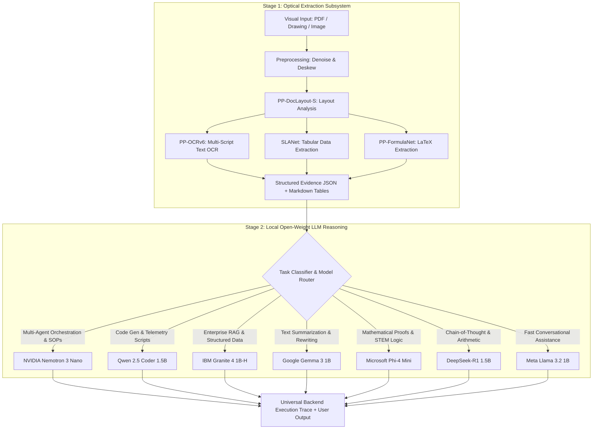

# OCR & Document Intelligence Engine Architecture

> **Engine**: PaddleOCR 3.7.0 · PP-OCRv6 Small · PP-StructureV3 · RapidOCR ONNX  
> **Python Compute**: `platform/ocr/`, `platform/python-compute/` (Port 8305)  
> **Node.js Client**: `platform/multimodal/ocr-engine.js`, `platform/multimodal/document-extractor.js`  
> **Mode**: 100% Offline · Air-Gapped · CPU-Primary with Dynamic CUDA Acceleration  
> **Status**: Production

---

## 1. Architecture Overview

The Sovereign AI Workbench incorporates a dedicated, high-throughput on-premise Document Intelligence & OCR Engine designed for industrial schematics, scanned refinery inspection reports, NDT ultrasonic logs, tax invoices, academic papers, and multi-page technical PDFs.

Because lightweight on-device LLMs (such as Google Gemma 3 1B and Meta Llama 3.2 1B) operate strictly in text mode, optical character recognition and document layout decomposition are handled prior to language model reasoning by this specialized vision subsystem.

```
INPUT (Scanned PDF / P&ID Drawing / Photograph / Invoice / Form / Screenshot)
  │
  ▼
Local Preprocessing & Normalization (Orientation Correction, Deskew, Denoise, CLAHE)
  │
  ▼
PP-DocLayout-S (23-Class Document Layout & Structural Block Segmentation)
  │
  ├────── Text Regions ────────> PP-OCRv6 Small (50 Languages + Tamil + Hindi)
  │                                    │
  ├────── Table Regions ───────> SLANet (Table Structure → HTML / Markdown / JSON)
  │                                    │
  └────── Formula Regions ─────> PP-FormulaNet-S (Math Expressions → LaTeX)
                                       │
                                       ▼
Topological Reading Order Reconstruction & Spatial Bounding Box Alignment
  │
  ▼
Canonical Structured Document Payload (JSON Schema / Markdown Tables / Citations)
  │
  ▼
Local LLM Reasoning & Synthesis (Nemotron 3 / Granite 4 / Qwen 2.5 / Gemma 3 / Phi-4 / DeepSeek-R1)
```

---

## 2. Model Inventory & Local Weight Manifest

All model weights are pre-bundled in the local application package with cryptographic SHA-256 verification at startup. **Zero runtime downloads or external network connections are permitted.**

| Model Component | Architecture / Purpose | Size | Execution Target | Language Scope |
| :--- | :--- | :--- | :--- | :--- |
| **PP-OCRv6 Small Det** | DBNet++ Text Region Detection | 9.6 MB | CPU / CUDA | Universal |
| **PP-OCRv6 Small Rec** | SVTR-LCNet Multi-Script Recognition | 14.5 MB | CPU / CUDA | 50 Latin & Common Scripts |
| **Text Orientation Cls** | MobileNetV2 0° / 180° Angle Classifier | 1.4 MB | CPU | Universal |
| **PP-DocLayout-S** | YOLO-based 23-Class Document Layout | 15.0 MB | CPU / CUDA | Universal Document Layouts |
| **SLANet** | Spatial Layout Attention Table Recognizer | 9.0 MB | CPU / CUDA | Universal Grid & Borderless Tables |
| **PP-FormulaNet-S** | Mathematical Expression to LaTeX | 12.0 MB | CPU / CUDA | Math & Scientific Notation |
| **Tamil Recognition** | `ta_PP-OCRv4_mobile_rec` (Dedicated) | 4.8 MB | CPU | Tamil Script |
| **Hindi Recognition** | `devanagari_PP-OCRv5_mobile_rec` (Dedicated) | 5.2 MB | CPU | Devanagari / Hindi Script |

- **Total Required Footprint**: ~49.5 MB
- **Total Footprint with Multi-Script Extensions**: ~71.5 MB

```
platform/ocr/models/
├── detection/PP-OCRv6_det_small/
├── recognition/PP-OCRv6_rec_small/
├── classification/ch_ppocr_mobile_v2.0_cls/
├── layout/PP-DocLayout-S/
├── table/SLANet/
├── formula/PP-FormulaNet-S/
├── languages/
│   ├── ta_PP-OCRv4_mobile_rec/
│   └── devanagari_PP-OCRv5_mobile_rec/
└── manifest.json
```

---

## 3. Two-Stage OCR → LLM Integration Pipeline

The workbench enforces a strict separation between **optical sensory perception** (Stage 1) and **epistemic reasoning** (Stage 2):



> [!IMPORTANT]
> **Gemma 3 1B and Llama 3.2 1B are text-only models**. They do not process raw pixel tensors. The Stage 1 PaddleOCR pipeline converts visual documents into deterministic, high-accuracy textual and tabular evidence tokens before language model prompting.

---

## 4. Hardware Scheduling & Single GPU Mutex

Operating on consumer hardware (NVIDIA GeForce RTX 2050 with 4GB VRAM) requires deterministic resource allocation:

| Operational Mode | OCR Device | LLM Device | Scheduling Guarantee |
| :--- | :--- | :--- | :--- |
| **Default Pipeline** | CPU (Multi-threaded OpenMP) | GPU (Ollama VRAM) | **Zero VRAM competition**. OCR runs on CPU while LLM is resident in GPU VRAM. |
| **Accelerated Batch OCR** | GPU (CUDA 12.5) | Unloaded / Idle | OCR utilizes CUDA for sub-second page batching when LLM inference is not in flight. |
| **Fallback Mode** | CPU (SIMD / AVX2) | CPU | 100% functional on non-CUDA systems. |

**Concurrency Mutex (`MAX_GPU_CONCURRENCY = 1`)**:
The workflow scheduler guarantees that GPU-heavy OCR kernels and Ollama LLM forward passes never contend for VRAM simultaneously, eliminating Out-Of-Memory (OOM) fatal crashes.

---

## 5. Supported Document Types & Processing Pipelines

| Document Type | Extensions | Processing Strategy | Output Formats |
| :--- | :--- | :--- | :--- |
| **Scanned PDF Reports** | `.pdf` | PyMuPDF page rasterization (300 DPI) → PP-DocLayout-S → PP-OCRv6 | Multi-page text, layout blocks, confidence scores |
| **Native Text PDFs** | `.pdf` | Multi-strategy Tj/TJ operator extraction with OCR image fallback | Clean content text (metadata and XMP filtered) |
| **P&ID / Engineering Schematics** | `.png`, `.jpg`, `.dwg`, `.dxf` | Adaptive CLAHE enhancement → High-res OCR → Instrument tag isolation (`TK-101`, `PSV-402`) | Tag maps, line connections, defect callouts |
| **Spreadsheets & Tables** | `.csv`, `.xlsx`, `.tsv` | Native parsing + SLANet visual table extraction | Markdown tables, JSON row arrays |
| **Industrial Inspection Forms** | Any image / PDF | Layout bounding box matching → Key-value field extraction | Key-value pairs (`Equipment ID`, `Thickness`, `Corrosion Rate`) |
| **Academic & Technical Papers** | `.pdf` | Document layout + SLANet tables + PP-FormulaNet LaTeX | Markdown with embedded LaTeX formulas and tables |

---

## 6. Python OCR Service API Contracts

The local Python compute server (`platform/ocr/service.py` / `platform/python-compute/` on port 8305) exposes high-speed REST endpoints:

### 6.1 Endpoints

| Route | Method | Payload | Purpose |
| :--- | :--- | :--- | :--- |
| `/ocr/image` | `POST` | `{ image_path?, image_base64?, lang?, options? }` | Single image text and block extraction |
| `/ocr/document` | `POST` | `{ file_path?, file_base64?, file_name?, lang?, options? }` | Multi-page document and PDF layout parsing |
| `/ocr/table` | `POST` | `{ image_base64?, options? }` | SLANet table structure recognition only |
| `/ocr/parse` | `POST` | `{ file_base64?, file_name?, extract_formulas: true }` | Full multi-modal document understanding |
| `/ocr/health` | `GET` | _None_ | Engine health, model integrity, and device status |

### 6.2 Authoritative Response Schema

```json
{
  "success": true,
  "documentId": "doc-1787555015294",
  "fileName": "API-653-Inspection-Report.pdf",
  "mimeType": "application/pdf",
  "pages": [
    {
      "pageNumber": 1,
      "confidence": 0.962,
      "text": "EQUIPMENT INSPECTION REPORT\nTag No: TK-101\nMinimum Measured Thickness: 5.90 mm\nRetirement Limit: 6.80 mm",
      "blocks": [
        {
          "type": "header",
          "bbox": [50, 30, 750, 80],
          "content": "EQUIPMENT INSPECTION REPORT",
          "confidence": 0.98
        },
        {
          "type": "key_value",
          "bbox": [50, 90, 400, 140],
          "key": "Tag No",
          "value": "TK-101",
          "confidence": 0.97
        }
      ],
      "tables": [
        {
          "pageNumber": 1,
          "tableName": "Ultrasonic Thickness Measurements",
          "headers": ["Course", "Nominal (mm)", "Actual (mm)", "Status"],
          "rows": [
            { "Course": "Course 1", "Nominal (mm)": "12.0", "Actual (mm)": "11.8", "Status": "PASS" },
            { "Course": "Course 3", "Nominal (mm)": "8.0", "Actual (mm)": "5.9", "Status": "CRITICAL" }
          ],
          "markdown": "| Course | Nominal (mm) | Actual (mm) | Status |\n| --- | --- | --- | --- |\n| Course 1 | 12.0 | 11.8 | PASS |\n| Course 3 | 8.0 | 5.9 | CRITICAL |"
        }
      ]
    }
  ],
  "fullText": "EQUIPMENT INSPECTION REPORT\nTag No: TK-101...",
  "confidence": 0.962,
  "metadata": {
    "pageCount": 1,
    "ocrEngine": "PaddleOCR 3.7.0 / PP-OCRv6 Small + SLANet",
    "device": "cpu",
    "isAirGapped": true,
    "externalCalls": 0
  }
}
```

---

## 7. Confidence Calibration & Thresholding

Every recognized character, line, and table bounding box is scored against calibrated confidence thresholds:

| Level | Threshold | Action | Visual Representation |
| :--- | :--- | :--- | :--- |
| **HIGH** | $\text{Confidence} \ge 0.90$ | Direct ingestion into LLM context without caveats. | Green Badge |
| **MEDIUM** | $0.70 \le \text{Confidence} < 0.90$ | Retained with soft verification flag in evidence graph. | Yellow Badge |
| **LOW** | $\text{Confidence} < 0.70$ | Preserved with low-confidence warning for human-in-the-loop review. | Red Badge |

---

## 8. Security & Sovereign Isolation

1. **Zero Data Egress**: All rasterization, OpenCV image processing, neural inference, and bounding box math occur inside local memory (`127.0.0.1:8305`).
2. **Path Traversal Protection**: Filenames and paths are sanitized using strict basename resolution to prevent arbitrary file read attacks.
3. **Transient File Lifecycle**: Ephemeral image rasters generated during PDF parsing are scrubbed from system memory immediately following feature extraction.
