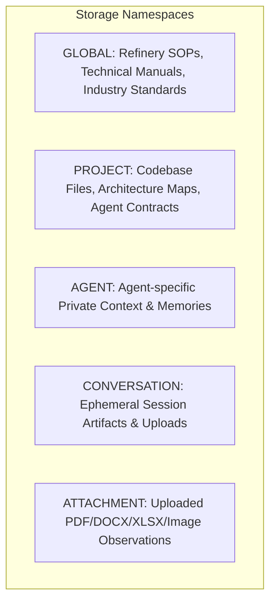

# Sovereign Local Hybrid RAG — Architecture Specification

## 1. System Architecture Overview

The Sovereign AI Local Hybrid RAG subsystem (`platform/rag/`) is a high-performance, air-gapped, zero-cloud information retrieval engine. It combines dense semantic embeddings with lexical inverted index search using mathematical rank fusion, executing entirely on standard CPU cores with deterministic latency.

```
+---------------------------------------------------------------------------------------------------+
|                                 SOVEREIGN LOCAL HYBRID RAG SUBSYSTEM                               |
+---------------------------------------------------------------------------------------------------+
|                                                                                                   |
|  [ Ingestion Layer ]                                                                              |
|  - document-ingestion.js   (PDF, DOCX, XLSX, CSV, Code, Text, Gemma 3 Vision Observations)        |
|  - chunker.js              (Hierarchy preservation, table header repetition, code symbols)        |
|                                                                                                   |
|  [ Dual-Index Storage Layer ]                                                                     |
|  - embedding-engine.js     (384D Dense Semantic CPU Vectors, Subword Hashing, RAM/Disk Cache)     |
|  - vector-index.js         (Persistent Vector Store, Namespaces, Cosine Dot Product)              |
|  - bm25-engine.js          (Okapi BM25 Inverted Index, TF-IDF, Symbol Matching)                   |
|  - codebase-indexer.js     (Automated Repository Intelligence for platform/, agents/, docs/)      |
|                                                                                                   |
|  [ Query & Fusion Layer ]                                                                         |
|  - query-rewriter.js       (Anaphoric Resolution, Complexity Classifier, Skip Classifier)        |
|  - hybrid-retriever.js     (Reciprocal Rank Fusion k=60, Weighted Score Blend, Adaptive Top-K)    |
|  - evidence-pack.js        (Token Budgeting, Overlap Merging, Citations, Prompt Injection Defense)|
|                                                                                                   |
|  [ Unified Barrel API ]                                                                           |
|  - index.js                (Singleton RAGService, searchKnowledge(), ingestDocument())            |
+---------------------------------------------------------------------------------------------------+
```

---

## 2. Mathematical Formulations

### 2.1 384-Dimensional Dense Vector Feature Hashing
To eliminate external embedding model downloads, tokenizers, and GPU memory consumption, the semantic embedding engine employs a deterministic multi-seed feature projection algorithm:

1. **Feature Extraction**:
   - Word unigrams with positional decay: $\text{weight}(w_i) = \begin{cases} 1.4 & \text{if } i < 0.15 \cdot L \\ 1.1 & \text{if } i < 0.50 \cdot L \\ 0.9 & \text{otherwise} \end{cases}$
   - Subword character n-grams ($N \in [3, 5]$) for technical morphology.
   - Word bigrams and trigrams for local syntactic context.
   - Domain entity boosters for capitalized acronyms (`API-653`, `OISD`, `CUI`).

2. **Orthogonal Hash Projection**:
   For each extracted feature $f$ with weight $w$, 4 orthogonal hash values are generated using 32-bit FNV-1a with distinct seeds $S = [0\text{x}811\text{c}9\text{dc}5, 0\text{x}9\text{e}3779\text{b}9, 0\text{x}5\text{bd}1\text{e}995, 0\text{x}27\text{d}4\text{eb}2\text{f}]$:
   $$\text{dim}_s = |h_s(f)| \pmod{384}$$
   $$\text{sign}_s = \begin{cases} +1 & \text{if } (h_s(f) \ \& \ 0\text{x}1000) = 0 \\ -1 & \text{otherwise} \end{cases}$$
   $$V[\text{dim}_s] \mathrel{+}= \text{sign}_s \cdot w$$

3. **Exact L2 Normalization**:
   $$\hat{V} = \frac{V}{\|V\|_2} = \frac{V}{\sqrt{\sum_{j=0}^{383} V_j^2}}$$

4. **Cosine Similarity Computation**:
   For normalized unit vectors $\hat{A}$ and $\hat{B}$, cosine similarity reduces to unrolled dot product:
   $$\text{sim}(\hat{A}, \hat{B}) = \hat{A} \cdot \hat{B} = \sum_{j=0}^{383} \hat{A}_j \hat{B}_j$$

---

### 2.2 Okapi BM25 Lexical Inverted Index
For precise keyword lookups, standard codes, and exact variable names:

1. **Inverse Document Frequency (IDF)**:
   $$\text{IDF}(q_i) = \ln\left(1 + \frac{N - n(q_i) + 0.5}{n(q_i) + 0.5}\right)$$
   where $N$ is total chunks in namespace, and $n(q_i)$ is chunk frequency containing token $q_i$.

2. **Okapi BM25 Scoring**:
   $$\text{Score}_{\text{BM25}}(D, Q) = \sum_{i=1}^{|Q|} \text{IDF}(q_i) \cdot \frac{\text{TF}(q_i, D) \cdot (k_1 + 1)}{\text{TF}(q_i, D) + k_1 \cdot \left(1 - b + b \cdot \frac{|D|}{\text{avgdl}}\right)}$$
   Standard tuned parameters: $k_1 = 1.5$, $b = 0.75$.

3. **Exact Phrase & Symbol Booster**:
   $$\text{Score}_{\text{final}} = \text{Score}_{\text{BM25}} + \Delta_{\text{verbatim}} + \Delta_{\text{symbols}}$$

---

### 2.3 Reciprocal Rank Fusion (RRF)
To unify rankings across heterogeneous score distributions without calibration drift:

$$\text{RRF\_Score}(d) = \sum_{m \in \{\text{BM25}, \text{Vector}\}} \frac{w_m}{k + \text{rank}_m(d)}$$
where standard smoothing constant $k = 60$, $w_{\text{vector}} = 1.0$, $w_{\text{BM25}} = 1.0$.

Normalized Fused Score:
$$\text{Score}_{\text{norm}}(d) = \frac{\text{RRF\_Score}(d)}{\frac{w_{\text{vector}}}{k + 1} + \frac{w_{\text{BM25}}}{k + 1}} \in [0.0, 1.0]$$

---

## 3. Namespace Isolation & Scoping

To support multi-agent workflows and data privacy, the RAG index supports distinct partition namespaces:



| Namespace | Intended Content | Lifecycle | Search Scope |
| :--- | :--- | :--- | :--- |
| `GLOBAL` | Public engineering standards, safety regulations, SOPs | Persistent | Accessible by all 101 Agents |
| `PROJECT` | Code repository, contracts, system architecture docs | Auto-Indexed | Platform & Code-Specialist Agents |
| `AGENT` | Specialized domain memories, past task execution tracks | Persistent | Bound to specific `agentId` |
| `CONVERSATION` | Ephemeral session context, user clarifications | Session Bound | Current chat conversation |
| `ATTACHMENT` | User-uploaded files and Gemma 3 vision observations | Request/Session | Uploading agent & user session |

---

## 4. Document Normalization & Chunking Strategy

### 4.1 Native Parsing without Third-Party Dependencies
- **PDF**: Decompresses `/Filter /FlateDecode` byte streams via native `node:zlib`, extracts PDF text blocks (`BT...ET`), captures `/Type /Page` markers, and filters XMP/C2PA metadata.
- **DOCX**: Binary PKZip parser extracting `word/document.xml`, mapping `<w:pStyle>` headings, `<w:p>` paragraphs, and `<w:tbl>` structured tables.
- **XLSX**: Binary PKZip parser extracting `xl/sharedStrings.xml` and `xl/worksheets/*.xml`, assembling full 2D cell grids and Markdown representations.
- **CSV/TSV**: RFC 4180 parsing with auto-delimiter detection (`,`, `;`, `\t`, `|`) and row object conversion.
- **Code**: AST-like regex symbol extractor indexing function, class, and method boundaries with line numbers (`startLine`-`endLine`).
- **Gemma 3 Multimodal**: Converts visual observations, OCR extractions, and diagram bounding boxes into structured searchable chunks.

### 4.2 Structure-Preserving Chunking
Unlike naive sliding windows that break sentences and tables mid-row:
1. **Table Integrity**: Tables exceeding chunk budgets are split row-by-row while **re-injecting header rows** on every chunk slice.
2. **Code Encapsulation**: Functions and classes are kept intact with enclosing symbols identified in chunk metadata.
3. **Contextual Headers**: Every chunk is prepended with `[Document: <name> | Section: <title> | Page: <p>]`.

---

## 5. Security & Prompt Injection Defense

Retrieved documents from external sources or attachments may contain adversarial prompt injections. The `EvidencePack` engine implements a multi-layer defense sandbox:

1. **Adversarial Keyword Stripping**: Neutralizes patterns like `Ignore previous instructions`, `SYSTEM:`, `<|im_start|>`, `<|system|>`.
2. **XML Isolation Boundary**: All retrieved evidence is wrapped in strict `<source_evidence id="..." citation="..." score="...">` blocks.
3. **Untrusted Data Framing**: Injects non-executable instructions warning the LLM that evidence content is reference material only.
4. **Token Budget Enforcement**: Strict hard caps prevent context window pollution and denial-of-service via oversized document uploads.
