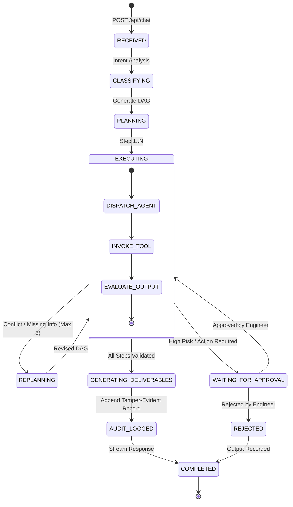

# Super AI — Technical Request Lifecycle & Data Contracts

This document specifies the exact state machine, communication protocols, JSON contracts, and error recovery policies governing every request processed by Super AI.

---

## 1. State Machine Transitions



---

## 2. Request & Response JSON Contracts

### A. Chat / Task Initiation Contract (`POST /api/chat`)
```json
{
  "agent_id": "auto",
  "task": "Perform ultrasonic thickness analysis for HX-204 and check API-653 limits",
  "model_override": "nemotron-3-nano",
  "attachments": [
    {
      "name": "HX-204_UT_Report.pdf",
      "type": "application/pdf",
      "size": 245760,
      "path": "E:\\Smart Automation\\100-AI-Agents\\data\\demo\\HX-204_UT_Report.pdf"
    }
  ]
}
```

### B. Standard Execution Response Contract
```json
{
  "status": "success",
  "trace_id": "trace-sih-20260822-094122-8300",
  "result": {
    "text": "### Investigation Summary for Heat Exchanger Shell HX-204\n\nUltrasonic thickness measurements confirm a minimum wall thickness of **5.90 mm** on Shell Course 3...",
    "confidence": {
      "level": "HIGH",
      "score": 0.95,
      "factors": ["Corroborated by 2024 and 2026 NDT readings", "API-653 Section 3.1 statutory limit confirmed"]
    },
    "evidence": [
      {
        "id": "ev-001",
        "type": "NDT_MEASUREMENT",
        "source": "HX-204_UT_Report.pdf (Page 3)",
        "content": "Measured shell thickness: 5.90 mm (Nominal: 10.00 mm, Corrosion Allowance: 3.20 mm)",
        "relationship": "SUPPORTS"
      }
    ],
    "deliverables": [
      {
        "name": "Approval_Note_HX204.docx",
        "type": "application/vnd.openxmlformats-officedocument.wordprocessingml.document",
        "size": 42100,
        "path": "E:\\Smart Automation\\100-AI-Agents\\artifacts\\Approval_Note_HX204.docx"
      }
    ],
    "execution_trace": {
      "plan_id": "plan-83921",
      "models_used": ["nemotron-3-nano", "gemma3:4b", "qwen2.5-coder:1.5b"],
      "agents_involved": ["agent-045", "agent-006", "agent-048", "agent-004", "agent-101"],
      "tools_executed": ["ocr_document_parser", "corrosion_rate_calculator", "statutory_limit_checker"],
      "replans_count": 0,
      "latency_ms": 1420,
      "egress_calls": 0
    }
  }
}
```

---

## 3. Invariant Error Handling & Fault Tolerance

1. **Air-Gap Guarantee**: Every network request is monitored by `egress-monitor.js`. If any module attempts to contact a public IP or DNS server, the socket is immediately terminated and an alert is recorded.
2. **Deterministic Fallbacks**: If a specialized agent encounters a timeout or syntax error, the execution engine dynamically substitutes an alternate capable agent from `registry/sih-agent-mapping.json` (e.g. Agent 005 Summarization fallback for Agent 049).
3. **Idempotent Storage**: All intermediate step states are persisted to `E:\Smart Automation\100-AI-Agents\data\context\`. If the platform restarts mid-task, execution can resume without data loss or re-running completed steps.
