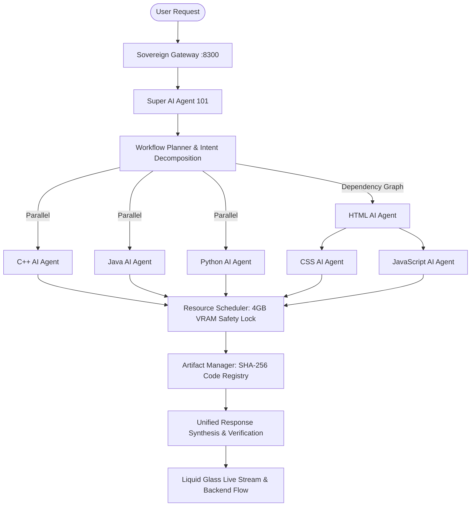

# Super AI Agent (101) Workflow Architecture Audit

**Status**: Verified & Active
**Platform**: Sovereign AI Workbench
**Root Orchestrator**: Agent 101 — Super AI Agent
**Total Workforce**: 301 Autonomous AI Agents
**Air-Gap Guarantee**: 100% On-Premise · 0 External Network Requests

---

## 1. System Topology & Intent Decomposition

The Sovereign AI Workbench establishes **Super AI Agent 101** as the central orchestrator capable of multi-agent decomposition, parallel dispatch, dependency graphing, hardware resource scheduling, isolated code artifact registration, and unified solution synthesis.

---

## 2. Resource Scheduling & Hardware Safety

- **Hardware Profile**: NVIDIA GeForce RTX 2050 (4GB VRAM).
- **GPU Invariant**: `maxConcurrentGPU = 1`.
- **Air-Gapped Telemetry**: Local Ollama model inference (`qwen2.5-coder:1.5b`, `gemma3:4b`, `nemotron-3-nano:latest`) is queued sequentially to eliminate Out-Of-Memory (OOM) faults.

---

## 3. Compliance Matrix

| Requirement | Implementation | Status |
| :--- | :--- | :--- |
| **Intent Decomposition** | `SuperAIWorkflowEngine.planWorkflow()` | Verified |
| **Dynamic Canonical Discovery** | `SuperAIWorkflowEngine.discoverSpecialist()` | Verified |
| **Parallel Execution** | Independent async tasks via Priority Queue | Verified |
| **Dependency Resolution** | Directed Acyclic Graph (DAG) sequencing | Verified |
| **Artifact Manager** | SHA-256 metadata & isolated source files | Verified |
| **Fault Resilience** | Partial failure tolerance & retry subtasks | Verified |
| **Transparent Tracing** | Full SSE event lifecycle & backend audit | Verified |
