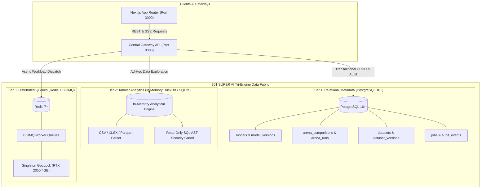
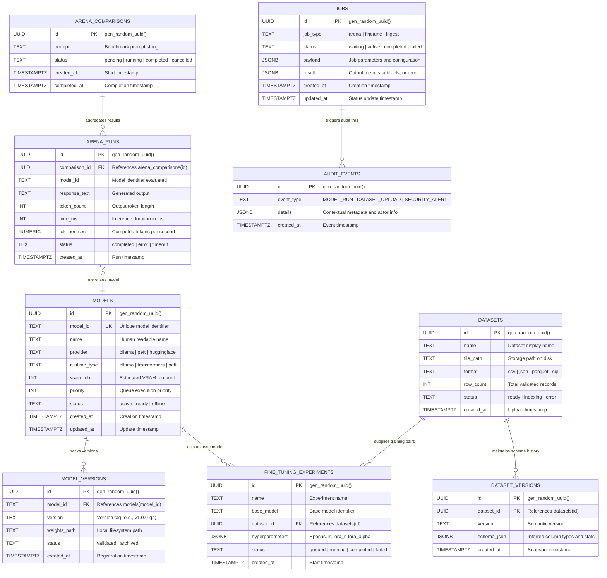
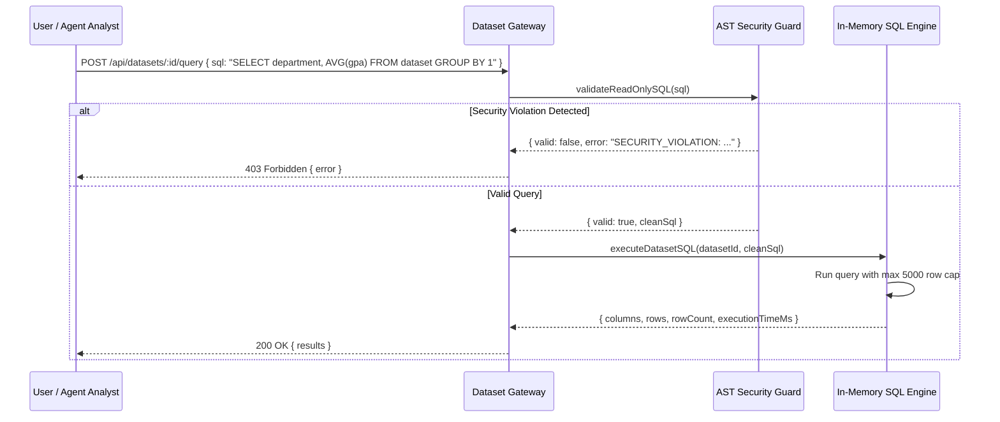
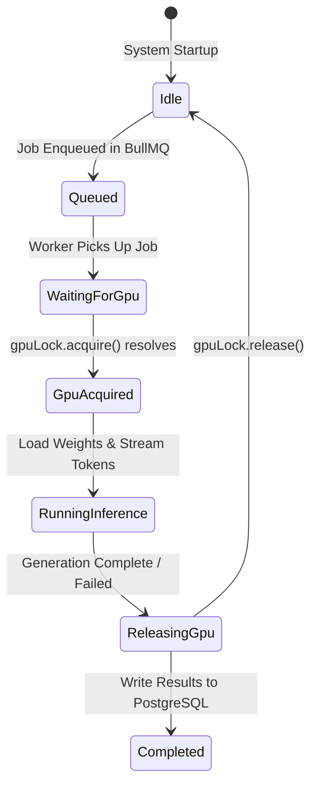
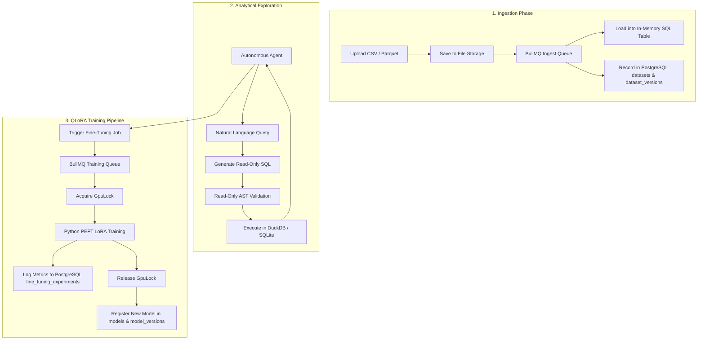

# 301 SUPER AI — Multi-Engine Database Architecture Specification

**Document Version**: 2.1.0  
**Date**: September 8, 2026  
**Architecture Classification**: Sovereign Industrial Tri-Engine Data Fabric  
**Hardware Profile**: NVIDIA GeForce RTX 2050 Laptop GPU (4GB VRAM) / 16GB RAM / Air-Gapped Local Host  

---

## 1. Architectural Overview: Tri-Engine Data Fabric

The **301 SUPER AI** platform employs a decoupled **Tri-Engine Data Fabric** designed to eliminate contention between persistent transactional state, analytical queries on ad-hoc datasets, and hardware-constrained background job queues.



---

## 2. Tier 1: PostgreSQL Enterprise Relational Store

PostgreSQL acts as the authoritative system-of-record for durable metadata, configurations, historical benchmarks, and governance audits.

### 2.1 Entity Relationship Diagram (ERD)



### 2.2 Indexing & Performance Strategy
1. **Lookup Accelerators**:
   - `CREATE INDEX idx_models_model_id ON models(model_id);`
   - `CREATE INDEX idx_model_versions_model_id ON model_versions(model_id);`
2. **Relational Joins**:
   - `CREATE INDEX idx_arena_runs_comparison_id ON arena_runs(comparison_id);`
   - `CREATE INDEX idx_dataset_versions_dataset_id ON dataset_versions(dataset_id);`
3. **Queue & Audit Filtering**:
   - `CREATE INDEX idx_jobs_status ON jobs(status);`
   - `CREATE INDEX idx_jobs_type ON jobs(job_type);`
   - `CREATE INDEX idx_audit_events_type ON audit_events(event_type);`

---

## 3. Tier 2: In-Memory DuckDB / Tabular SQL Engine

The analytical tier is implemented in `platform/datasets/sql-engine.js` and provides sub-millisecond querying over tabular data without contaminating persistent relational tables with ad-hoc schemas.

### 3.1 Security Sandbox & AST Validation (`validateReadOnlySQL`)
Before query execution, incoming SQL is parsed and inspected against a strict security policy:
- **Disallowed Multiple Statements**: Semicolon inspection outside string literals prevents query stacking and SQL injection.
- **Strict Read-Only Enforcement**: Query must start with `SELECT`, `WITH`, or `EXPLAIN`.
- **Forbidden DDL/DML Keywords**:
  `DROP`, `DELETE`, `UPDATE`, `INSERT`, `ALTER`, `CREATE`, `TRUNCATE`, `REPLACE`, `UPSERT`, `ATTACH`, `DETACH`, `PRAGMA`, `VACUUM`, `LOAD_EXTENSION`, `SYSTEM`, `EXEC`.
- **Memory Lifetime**: Data is parsed into memory structures on ingestion and garbage-collected upon dataset deletion.



---

## 4. Tier 3: Redis + BullMQ Job Queue Subsystem

Background operations that require substantial compute or access to the local GPU are orchestrated asynchronously through Redis 7+ and BullMQ (`platform/jobs/`).

### 4.1 Queue Topologies
- **`superai:model-arena`**: Manages model evaluation comparisons across local LLMs.
- **`superai:finetune`**: Manages LoRA/QLoRA training jobs using the Python PEFT worker.
- **`superai:dataset-ingest`**: Processes large CSV/Parquet uploads, calculates summary statistics, and embeds documentation.

### 4.2 Hardware GPU Mutual Exclusion (`GpuLock`)
The system runs on an NVIDIA GeForce RTX 2050 with a strict 4096 MB VRAM ceiling. Concurrent model loads trigger CUDA out-of-memory (OOM) errors. The queue worker integrates with `GpuLock` (`platform/jobs/gpu-lock.js`):



---

## 5. Cross-Database Interoperability & Data Flow



---

## 6. Disaster Recovery, Backup & Air-Gapped Migration Strategy

### 6.1 Database Backup Strategy
- **Logical Backups**:
  Daily automated snapshot using `pg_dump`:
  ```bash
  pg_dump -h localhost -U superai_user -d superai_db -Fc -f /backup/superai_db_$(date +%Y%m%d).dump
  ```
- **Air-Gapped Cold Storage**:
  Backups and model adapter checkpoints are stored on encrypted, sovereign local volumes without reliance on external cloud storage.

### 6.2 Schema Evolution & Migrations
- Migration files are strictly numbered (`001_initial_schema.sql`, `002_*.sql`).
- All migrations are idempotent, tested against clean instances, and tracked in `schema_migrations`.
- Down migrations and rollback procedures are formally documented and automated in `migrator.js`.

---

## 7. Architecture Verification Summary

| Component | Technology | Concurrency Model | Primary Safety Gate |
| :--- | :--- | :--- | :--- |
| **Relational Metadata** | PostgreSQL 16+ | Connection Pool (`max: 10`) | Foreign keys, UUID constraints, ACID transactions |
| **Tabular Analytics** | In-Memory DuckDB / SQLite | Isolated per-dataset instances | `validateReadOnlySQL` AST security parser |
| **Job Queues** | Redis 7+ / BullMQ | FIFO Queue Worker | `GpuLock` singleton 1-at-a-time GPU hardware gate |
| **Model Registry** | PostgreSQL + Filesystem | Read-heavy caching | Version hash checking and VRAM reservation |
