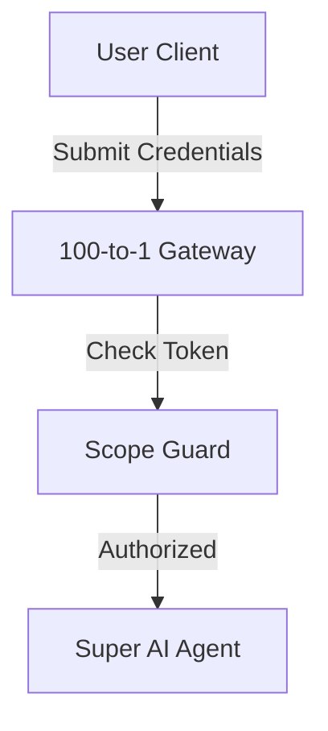

# Diagrammatic Output Subsystem: Developer & Agent Authoring Guide

**Document Reference:** `docs/development/DIAGRAM-DEVELOPER-GUIDE.md`  

---

## 1. How Agents Produce Diagrams

Agents can output diagrams in two simple formats inside their response text:

### Format A: Mermaid Code Block
```markdown
Here is the authentication flow:



The gateway parses the token before dispatching.
```

### Format B: Structured JSON Diagram Block
```markdown
```diagram
{
  "type": "architecture",
  "title": "Industrial Monitoring Subsystem",
  "nodes": [
    { "id": "sens", "name": "NDT Sensors", "role": "Ultrasonic & Thermal", "layer": "Sensors" },
    { "id": "edge", "name": "Local Gateway", "role": "Port 8300 Daemon", "layer": "Edge" },
    { "id": "ai", "name": "Super AI Agent 101", "role": "Autonomous Analysis", "layer": "Analytics" }
  ],
  "edges": [
    { "from": "sens", "to": "edge", "label": "Telemetry" },
    { "from": "edge", "to": "ai", "label": "Analysis Request" }
  ]
}
```
```

### Format C: Data Chart Block
```markdown
```chart
{
  "type": "bar_chart",
  "title": "Quarterly Sensor Readings",
  "x": { "values": ["PUMP-101", "PUMP-102", "PUMP-103"] },
  "series": [
    { "name": "Vibration (mm/s)", "values": [1.2, 4.8, 2.1] }
  ]
}
```
```

---

## 2. Programmatic API

```javascript
import { DiagramRenderer, VisualType } from './platform/visuals/index.js';

// Render a flowchart card HTML
const cardHtml = DiagramRenderer.renderCard({
  type: VisualType.FLOWCHART,
  title: 'Workflow',
  nodes: [{ id: '1', label: 'Start' }, { id: '2', label: 'Finish' }],
  edges: [{ from: '1', to: '2' }]
}, { title: 'Workflow Card' });
```
