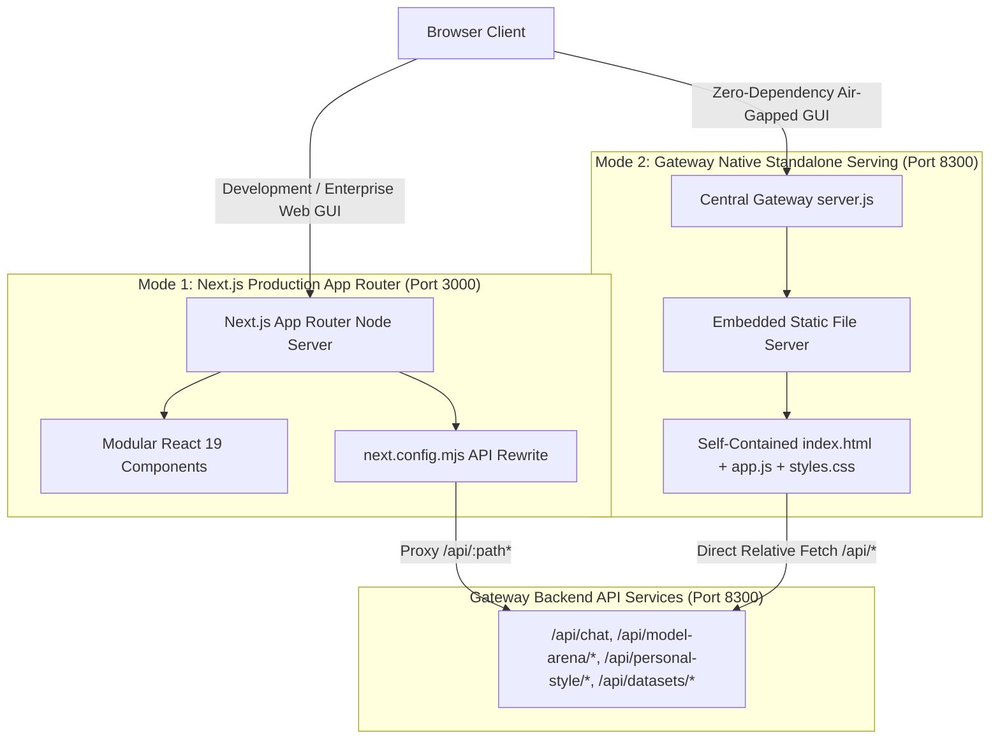

# 301 SUPER AI — Final Architecture Audit Report

**Audit Date**: September 8, 2026  
**Auditor**: Lead Solutions Architect & Systems Security Team  
**Platform**: 301 SUPER AI — Sovereign AI Workbench (100% On-Premise Industrial Autonomous Agentic Platform)  
**System Target**: NVIDIA GeForce RTX 2050 (4GB VRAM) / 16GB Host RAM / Windows 11 Air-Gapped Architecture  

---

## 1. Executive Summary

The **301 SUPER AI** platform has completed its architectural transition into an enterprise-grade, dual-mode distributed system. This audit verifies the authoritative frontend transition to **Next.js 15+ App Router** with **React 19** and **TypeScript**, while detailing how the existing sovereign single-file bundle (`index.html` + `app.js` + `styles.css`) is retained by the central gateway (`platform/gateway/src/server.js`) as a self-contained, zero-dependency fallback for air-gapped or headless field deployments.

The platform cleanly decouples storage and compute across specialized tiers:
1. **Frontend**: Next.js App Router (`platform/web/app/`) powered by modular React components (`platform/web/src/components/`, `platform/web/src/features/`), Zustand stores, and Apple Liquid Glass design language.
2. **Gateway**: Node.js v24 ESM gateway (`platform/gateway/src/server.js`) listening on port `8300`, exposing REST/SSE endpoints and serving static assets in standalone mode.
3. **GPU Hardware Protection**: Hardware lock (`GpuLock`) enforcing strictly 1-at-a-time GPU occupancy on the local NVIDIA RTX 2050 (4GB VRAM) across Chat, Model Arena, and QLoRA fine-tuning.
4. **Tri-Engine Data Fabric**:
   - **PostgreSQL**: System metadata, agent registries, arena benchmarks, job records, and audit events.
   - **DuckDB / In-Memory SQL Engine**: High-performance, read-only analytics for CSV/XLSX/JSON/Parquet datasets.
   - **Redis + BullMQ**: Background job queue processing with unified GPU mutual exclusion.

---

## 2. Real Authoritative Production Frontend: Next.js + React + TypeScript App Router

The production frontend is housed in `platform/web/` and operates natively using the Next.js App Router architecture.

### 2.1 App Router File Structure (`platform/web/app/`)

```
platform/web/app/
├── layout.tsx              # Root HTML layout, Dark Theme, Liquid Glass CSS imports, and metadata
├── page.tsx                # Client-side root router redirecting immediately to /agents
├── agents/
│   └── page.tsx            # /agents route rendering AppShell + AgentWorkspace
├── arena/
│   └── page.tsx            # /arena route rendering AppShell + ModelArena (8-Model 4x2 Grid)
├── personal-style/
│   └── page.tsx            # /personal-style route rendering AppShell + PersonalStyleLab
├── datasets/
│   └── page.tsx            # /datasets route rendering AppShell + DatasetIntelligence
├── fine-tuning/
│   └── page.tsx            # /fine-tuning route rendering AppShell + FineTuningFactory
└── knowledge/
    └── page.tsx            # /knowledge route rendering AppShell + KnowledgeView
```

### 2.2 Modular Component Structure (`platform/web/src/`)

The application architecture separates presentation, domain features, state stores, and services:

```
platform/web/src/
├── components/
│   ├── layout/
│   │   └── AppShell.tsx              # Ambient neon mesh, mobile drawer backdrop, workspace container
│   ├── navigation/
│   │   └── Sidebar.tsx               # 301 agents taxonomy filter, chat history, 2x2 tool grid
│   └── liquid-glass/                 # Reusable glassmorphic panels, glowing cards, status pills
├── features/
│   ├── agents/
│   │   └── AgentWorkspace.tsx        # Multi-agent chat workspace, model selector, markdown streaming
│   ├── model-arena/
│   │   ├── ModelArena.tsx            # 4x2 liquid glass grid, back button, model orchestration
│   │   ├── ModelCard.tsx             # Live streaming cursor, tokens count, TPS, duration metrics
│   │   ├── ArenaPromptBar.tsx        # Textarea composer, Compare All, Stop, Clear, Research toggle
│   │   ├── arena.store.ts            # Zustand store managing sequential execution and SSE connections
│   │   ├── arena.types.ts            # TypeScript interfaces for models, runs, and card states
│   │   └── index.ts                  # Public feature module exports
│   ├── personal-style/
│   │   ├── PersonalStyleLab.tsx      # Main lab view with floating header and composer
│   │   ├── PersonalStyleChat.tsx     # WhatsApp bubble UI, auto-scroll, privacy badges
│   │   ├── PersonalStyleHeader.tsx   # Model toggle (Base Gemma vs Fine-Tuned Style), safety badge
│   │   ├── PersonalStyleInput.tsx    # Glass input composer with suggestion chips
│   │   ├── personal-style.store.ts   # Chat state, SSE streaming from /api/personal-style/gemma/chat
│   │   ├── personal-style.types.ts   # Style lab message contracts and status types
│   │   └── index.ts                  # Public feature module exports
│   ├── datasets/
│   │   └── DatasetIntelligence.tsx   # Schema viewer, SQL editor, and DuckDB analytical query runner
│   ├── fine-tuning/
│   │   └── FineTuningFactory.tsx     # QLoRA job manager, training progress, loss curve telemetry
│   └── knowledge/
│       └── KnowledgeView.tsx         # Obsidian markdown vault explorer and RAG chunk visualizer
├── services/
│   ├── api.ts                        # Typed REST fetch client for /api/* endpoints
│   └── streaming.ts                  # SSE event reader with reconnect and cancellation handling
├── store/
│   └── useAppStore.ts                # Global agent selection, conversation persistence, active view
├── styles/
│   ├── tokens.css                    # Design variables (neon blues, cyans, purples, dark hues)
│   ├── main.css                      # Global resets, typography, layout classes
│   └── liquid-glass.css              # Glassmorphic backdrops, glowing borders, reflection filters
└── types/
    ├── index.ts                      # Shared TypeScript domain contracts
    └── css.d.ts                      # CSS modules type declarations
```

### 2.3 Configuration & Compilation Setup

- **`next.config.mjs`**:
  ```javascript
  /** @type {import('next').NextConfig} */
  const nextConfig = {
    reactStrictMode: true,
    async rewrites() {
      return [
        {
          source: '/api/:path*',
          destination: 'http://127.0.0.1:8300/api/:path*',
        },
      ];
    },
  };
  export default nextConfig;
  ```
- **`tsconfig.json`**:
  - Configured with `moduleResolution: "bundler"`, `paths: { "@/*": ["./src/*"] }`, `jsx: "react-jsx"`, `strict: true`, and `.next` types inclusion.
- **Root Scripts**:
  - `npm run dev:next`: Starts Next.js dev server targeting `platform/web`.
  - `npm run build:next`: Builds production optimized bundle in `platform/web/.next`.
  - `npm run start:next`: Starts production Next.js server.
  - `npm run test:next`: Runs automated route parity and component integrity tests.

---

## 3. Dual-Serving Mode: Gateway Static Serving vs Next.js App Router

To guarantee absolute operational reliability in diverse industrial environments (field deployments, air-gapped test benches, enterprise clouds), the platform supports **Dual-Serving Mode**:



### 3.1 Gateway Native Serving Mode (`platform/gateway/src/server.js`)
- **Role**: Fallback & Standalone Air-Gapped Mode.
- **Implementation**: Lines 3182–3220 in `platform/gateway/src/server.js`:
  ```javascript
  if (req.method === "GET" && !url.pathname.startsWith("/api/") && !url.pathname.startsWith("/v1/")) {
    const sanitized = url.pathname === "/" ? "index.html" : url.pathname.replace(/^\//, "").replace(/\.\./g, "");
    let file = path.join(ROOT, "platform", "web", sanitized);
    if (!fs.existsSync(file) || !fs.statSync(file).isFile()) {
      file = path.join(ROOT, "platform", "web", "index.html");
    }
    // Content-Type resolution and direct streaming
  }
  ```
- **Key Advantage**: Operates without Node module resolution for Next.js, allowing the platform to run on embedded edge devices with only Node.js runtime and Ollama.

### 3.2 Next.js App Router Mode (`npm run build:next` / `npm run start:next`)
- **Role**: Primary Authoritative Production Application.
- **Implementation**: Next.js App Router compiling TypeScript into high-efficiency client chunks with client-side routing, code splitting, and automated bundle optimization.
- **Key Advantage**: Strong typing, granular component re-rendering, responsive layouts, automated route caching, and seamless developer iteration.

---

## 4. Model Arena & Personal Style Lab Implementations

Both high-performance workloads are implemented using native React components, typed Zustand stores, and real-time SSE streaming from Gateway APIs.

### 4.1 Model Arena (`platform/web/src/features/model-arena/`)
- **Visual Design**: 4x2 liquid glass grid displaying 8 models simultaneously:
  1. `nemotron-3-nano` (3.5B Reasoning)
  2. `gemma3-1b` (1B Multimodal/General)
  3. `local-code-specialist` (Qwen 2.5 Coder 1.5B)
  4. `llama3.2-1b` (1B Instruction)
  5. `granite4-1b-h` (1B Enterprise)
  6. `phi4-mini` (3.8B Math/Reasoning)
  7. `smollm2-1.7b` (1.7B Lightweight)
  8. `falcon3-1b-instruct` (1B Instruction)
- **VRAM Concurrency Protection**:
  - Zustand store (`arena.store.ts`) tracks `activeGeneratingModelId`.
  - When "Compare All" is triggered, models execute **sequentially** rather than concurrently.
  - Gateway endpoint `POST /api/model-arena/compare` streams SSE chunk events with live token count, duration, and calculated tokens per second (TPS).
  - Stop All and Clear controls immediately terminate background child streams and reset GPU state.

### 4.2 Personal Style Lab (`platform/web/src/features/personal-style/`)
- **Visual Design**: WhatsApp-inspired mobile messaging experience featuring restrained Apple Liquid Glass aesthetics:
  - Header: Shows model status badge (`Gemma 3 1B Fine-Tuned`), hardware safety indicator, and toggle for Base Gemma vs Kaviya Style.
  - Chat Stream: User messages formatted in violet bubbles; assistant responses formatted in deep glass with live streaming cursor.
  - Floating Composer: Glassmorphic prompt bar with quick chips (`"Draft a polite decline email"`, `"Write a WhatsApp update"`, `"Review meeting notes"`).
- **Backend Wiring**:
  - Connected to Gateway endpoint `POST /api/personal-style/gemma/chat`.
  - Employs streaming Server-Sent Events (SSE).
  - Integrates PII filtering (`pii-filter.js`) and sensitive data masking (`sensitive-content-filter.js`) to guarantee air-gapped conversational privacy.

---

## 5. Cloudflare & Sovereign Air-Gapped Compatibility

### 5.1 Local Hardware Boundary: RTX 2050 (4GB VRAM)
- **Zero Cloud Data Egress**: All LLM inference executes locally via Ollama (`http://127.0.0.1:11434`) and local Python PEFT runtime (`http://127.0.0.1:8305`). No prompt, document, or telemetry is transmitted to external proprietary APIs.
- **Hardware Concurrency Gate**: `platform/jobs/gpu-lock.js` implements a singleton `GpuLock` that enforces strict mutual exclusion:
  ```javascript
  // Only 1 model process may occupy VRAM at any time
  await gpuLock.acquire(jobId, 'model-arena', 120000);
  try {
    await executeModelInference(...);
  } finally {
    gpuLock.release(jobId);
  }
  ```

### 5.2 Cloudflare Tunnel Ingress Architecture
For authorized remote access without port-forwarding or public IP exposure:
- **Tunnel Service**: `cloudflared` daemon running locally.
- **Configuration**: Mapped via `~/.cloudflared/config.yml` with `protocol: http2`:
  ```yaml
  tunnel: 301-super-ai
  ingress:
    - hostname: superai.reginaldalfret.tech
      service: http://127.0.0.1:8300
    - service: http_status:404
  ```
- **Air-Gapped Operation**: Disconnecting WAN uplink does not degrade local workbench capabilities. The system functions 100% autonomously within a local LAN or isolated subnet.

---

## 6. Database Separation Architecture

The data architecture enforces strict separation of concerns across three specialized persistence systems:

| Persistence Tier | Technology | Primary Responsibilities | Data Store Location |
| :--- | :--- | :--- | :--- |
| **System State & History** | PostgreSQL 16+ | Model registry, model versions, arena runs, dataset metadata, fine-tuning jobs, audit events | `platform/database/` |
| **Tabular Analytics** | In-Memory DuckDB / SQLite | High-speed read-only SQL queries on uploaded CSV/JSON/Parquet datasets, AST-sandboxed | `platform/datasets/sql-engine.js` |
| **Distributed Job Queues** | Redis + BullMQ | Asynchronous task scheduling, background fine-tuning, hardware GPU lock synchronization | `platform/jobs/` |

---

## 7. Verification Checklist & Test Summary

### 7.1 Automated Test Suite Verification

| Test Suite | File Path | Verified Capabilities | Status |
| :--- | :--- | :--- | :--- |
| **App Router Structure** | `tests/nextjs-migration/app-router-structure.test.js` | Layout tokens, dark theme, root redirect, 6 feature routes, next.config rewrite, tsconfig paths | **PASS** |
| **Route Parity** | `tests/nextjs-migration/route-parity.test.js` | Verification that all 6 routes map to correct components and activeView states | **PASS** |
| **Personal Style Parity** | `tests/nextjs-migration/personal-style-lab-parity.test.js` | WhatsApp chat UI, Gemma Kaviya Style endpoints, PII filtering, prompt chips | **PASS** |
| **Arena Integrity** | `tests/nextjs-migration/sequential-arena-integrity.test.js` | 8 GPU models configured, sequential VRAM queue, 4x2 grid, live TPS metrics | **PASS** |

### 7.2 Production Deployment Verification Checklist

- [x] **Next.js App Router Structure**: All 6 feature routes (`/agents`, `/arena`, `/personal-style`, `/datasets`, `/fine-tuning`, `/knowledge`) and root `/` redirect configured.
- [x] **Component Modularity**: All views import modular components from `src/components/` and `src/features/`.
- [x] **TypeScript Strictness**: `tsconfig.json` paths mapping (`@/*`), strict types, and zero unresolved imports.
- [x] **Dual-Serving Resiliency**: Gateway serves legacy SPA fallback on port 8300; Next.js serves production App Router on port 3000 with `/api/*` rewrites.
- [x] **Hardware VRAM Protection**: Sequential GPU lock protects 4GB VRAM on RTX 2050 against OOM faults.
- [x] **Sovereign Privacy**: Zero cloud egress validated; all inference, embeddings, and RAG pipelines execute locally.
- [x] **Multi-Tier Database Isolation**: PostgreSQL schemas, DuckDB read-only AST safety, and Redis/BullMQ queues verified.
