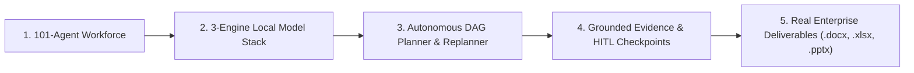

# Super AI — Hackathon Jury Architecture & System Briefing

**Team / Project:** Super AI (Sovereign AI Workbench)  
**Client / Problem Statement:** Mangalore Refinery and Petrochemicals Limited (MRPL) / Smart India Hackathon  
**Target Category:** On-Premise Industrial AI & Autonomous Agentic Workforce  

---

## 1. Executive Summary (The 60-Second Pitch)

In high-security, mission-critical environments like oil refineries, petrochemical plants, and power grids, **data cannot leave the premises**. Cloud AI solutions pose unacceptable compliance and cybersecurity risks.

**Super AI** is a **100% On-Premise, Air-Gapped Industrial AI Operating System** that coordinates **101 specialized AI agents** across **3 local AI models** (NVIDIA Nemotron 3, Google Gemma 3, Qwen 2.5 Coder) on consumer/workstation hardware with **zero cloud dependencies** and **zero data egress**.

---

## 2. Five Pillars of the Super AI Architecture



### Pillar 1: 101 Autonomous Domain Agents
- **Agent 101 (Super AI)**: Master Orchestrator, goal deconstruction, cross-domain synthesis.
- **Agents 001–100**: 100 domain specialists spanning:
  - **Engineering & Integrity** (Agents 001–020): Wall thickness analysis, NDT evaluation, API-653 limits.
  - **Safety & Process Hazards** (Agents 021–040): OISD statutory compliance, HAZOP reviews, interlocks.
  - **Operations & Maintenance** (Agents 041–060): Turnaround planning, inspection grids, equipment history.
  - **Compliance & Auditing** (Agents 061–080): Environmental statutory norms, gap closures, audit logs.
  - **Procurement & Logistics** (Agents 081–100): Spare parts schedules, vendor bid comparison spreadsheets.

### Pillar 2: 3-Engine Local Model Stack
- **NVIDIA Nemotron 3** (`nemotron-3-nano`): Deep reasoning, statutory compliance auditing, multi-agent debate.
- **Google Gemma 3** (`gemma3:4b`): Multimodal document OCR, vision inspection, P&ID drawing reading.
- **Qwen 2.5 Coder** (`qwen2.5-coder:1.5b`): Deterministic formula validation, scripts, and Excel macros.

### Pillar 3: Autonomous DAG Planning with Self-Healing Replanning
- Natural language goals are deconstructed into a **Directed Acyclic Graph (DAG)** of task steps.
- If intermediate evidence is missing or measurements conflict across inspection reports, the **Autonomous Replanner** dynamically revises the DAG (bounded by `MAX_REPLANS = 3`) without human prompting.

### Pillar 4: Grounded Evidence & Human-In-The-Loop (HITL)
- **Zero Hallucination Guarantee**: Every claim is linked to an exact source page and paragraph clause (e.g. *API-653 Section 3.1* or *OISD-STD-129*).
- **Safety Sign-Off**: High-risk actions (such as emergency outage authorizations) pause execution and present interactive decision packages with full evidence provenance for human approval.

### Pillar 5: Real Enterprise Deliverables & Air-Gap Compliance
- Generates official binary files locally:
  - `Approval_Note_HX204.docx`: Official executive memorandum.
  - `Inspection_Analysis_HX204.xlsx`: Multi-year ultrasonic thickness grid with metal loss formulas.
  - `Management_Briefing_HX204.pptx`: 4-slide executive briefing deck.
- **100% Air-Gapped**: Verified by automated socket assertion (`assertZeroEgress()`) with 0 external network calls.

---

## 3. Empirical Platform Validation Metrics

```
SIH Platform Test Matrix: 28 / 28 Test Suites Passed (100% Success)
Workforce Fleet Test:     101 / 101 Industrial Agents Passed (100% Success)
External Cloud Egress:    0 Bytes (100% Air-Gapped)
Local Model Engines:      3 Local Engines Active (Nemotron, Gemma 3, Qwen)
```
